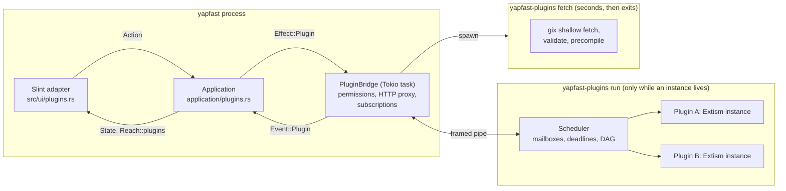
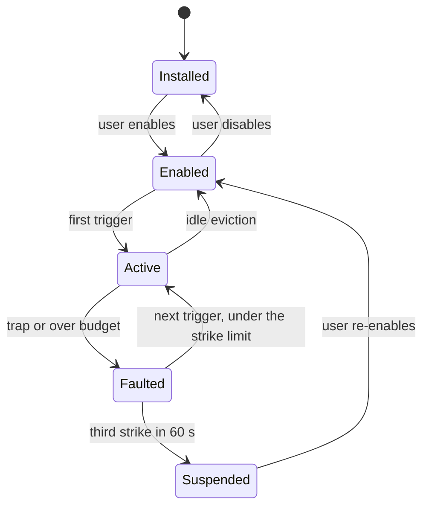
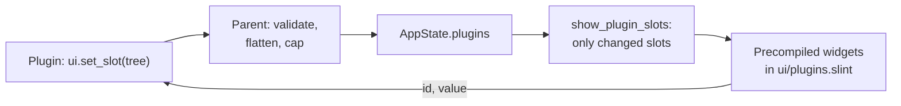

# Yapfast plugins: implementation plan

A proposal built on `SKELETON_PLUGIN_DRAFT.md`. It answers each question the
draft raises, and backs the memory and speed decisions with numbers measured
against Extism 1.41.0 (wasmtime 49.0.5) and against this repository's code.

**Status:** M0 implementation in progress: the protocol, helper, fixtures and
measurement harness have landed. M0 has not exited: its latency budget is not
met by the current Windows measurements, and Linux and Go/Rust checks remain.

---

## 1. The plan in one page

### The shape

- Plugins run in **a small helper process, `yapfast-plugins`**, which exists
  only while at least one plugin instance is alive. When none is, the process
  is gone and so is all of its memory.
- What a plugin adds to the interface (commands, menu items, buttons,
  settings) is **declared in its manifest**, so Yapfast can show it without
  loading any WebAssembly. A plugin is **activated on first use**, not at
  startup.
- **UI is data.** Plugins send a small description of widgets, and precompiled
  Slint components draw it. No `slint-interpreter`, no `.slint` from plugins,
  no runtime compilation of any kind.
- **Install is git.** Paste any https git URL; Yapfast resolves it to a commit,
  checks the `.wasm` in that commit, and records the commit and a SHA-256 in a
  lock file. The marketplace is itself a git repository.

### The draft's questions, answered

| The draft asks | Answer | Section |
| --- | --- | --- |
| Don't load anything if no plugin is enabled | No process, thread, engine or model. Costs one `Option` check on hot paths | [§4](#4-lifecycle-and-hot-reload) |
| Hot reload without restarting | Enable, disable and update swap one plugin in the running helper. UI is data, so Slint has nothing to reload | [§4.3](#43-hot-reload) |
| Parallel startup with a dependency graph | Compilation ignores the graph and runs in parallel; only `on_activate` follows it, layer by layer | [§7](#7-dependencies-and-parallel-loading) |
| Extism is single-threaded: pools, or a high-level API? | High-level API. One instance per plugin, host-managed async, no pools. Extism's `Pool` defaults to one instance per CPU | [§5](#5-threading-and-scheduling) |
| `.wasm` in git, not GitHub Releases | Yes, over any https git host, using `gix` in a short-lived process | [§8](#8-distribution-git-lock-file-marketplace) |
| Popup: "plugin wants to access example.com" | Yes, but through Yapfast's own network gate: Extism's `allowed_hosts` is fixed when the plugin is built, and can't ask | [§9](#9-permissions) |
| Default memory-page limit | **256 pages (16 MiB)** per instance, up to 1024 (64 MiB) with visible consent | [§6.2](#62-the-page-limit) |
| Vencord-like APIs | Vencord's APIs mapped one by one, and its plugins surveyed for the abilities and permissions Yapfast's API should offer | [§10](#10-plugin-api), [§17](#17-abilities-the-api-needs) |
| UI hooks | Fixed slots plus a precompiled widget set | [§11](#11-ui-hooks-without-a-slint-compiler) |
| Changing built-in UI | Named changes only: edit rows, hide parts, restyle, replace a few parts | [§11.7](#117-changing-built-in-ui) |
| Marketplace with images | A git registry with its icons inside it, loaded only while the page is open | [§8.6](#86-marketplace) |

### Budgets this plan commits to

These are acceptance criteria. Measure them as
`docs/measurements/README.md` describes: `measure` profile, `RssAnon`,
alternated builds with the spread reported.

| Scenario | Budget |
| --- | --- |
| Plugins compiled in, none enabled | +0 processes, +0 threads, parent `RssAnon` within noise (≤ 100 KiB), idle CPU unchanged, no timers |
| Enabled, none activated yet | As above, plus ≤ 16 KiB per plugin for its registry entry |
| Last plugin disabled or evicted | Helper exited; parent back within 256 KiB of its earlier level |
| Helper alive with one small plugin | ≤ 6 MiB `RssAnon` |
| Ten activated plugins with 2 MiB modules | ≤ 16 MiB `RssAnon` before their own heaps |
| Event to a subscribed plugin, 1 KiB | ≤ 50 µs p99 of overhead, pipe included |
| Event nobody subscribed to | One relaxed atomic load |
| Startup with installed plugins, none needing `startup` | ≤ 1 ms added on the UI thread |
| UI thread | Never runs WebAssembly, never waits on the helper |

---

## 2. What was measured

Everything below comes from a throwaway crate outside this repository, built
with the release profile (`strip = true`, `lto = "off"`) on Linux with 28
hardware threads. `RssAnon` was read after `malloc_trim(0)`. These are single
runs, good for choosing a design; milestone M0 repeats the numbers that matter
under the repository's measurement rules.

The real module is `wasm/code.wasm` from the Extism repository: a 1.87 MiB
Rust PDK build.

### Costs

| Measurement | Result |
| --- | --- |
| Extism + wasmtime + Cranelift, `default-features = false` | 17.6 MiB stripped binary |
| `gix` depth-1 clone over https (reqwest + rustls) of Extism's repository, 3.7 MiB on disk, then reading and hashing a 1.87 MiB blob | 11.4 MiB binary, 1.5 s, **18 MiB peak** |
| Empty process before Extism | 0.6 MiB `RssAnon` |
| One plugin, compiled, instantiated, called | 2.9 MiB total |
| Each further plugin, loaded with `Wasm::file` | **about 0.56 MiB** |
| Each further plugin, loaded with `Wasm::data` | **about 4.1 MiB** |
| Instantiating a compiled plugin | 0.05–0.5 ms |
| Cold compile of the 1.87 MiB module | 22 ms on all cores, 70–90 ms with two |
| Same, from wasmtime's on-disk cache | **2.8 ms**, no compile threads, 120 KiB on disk |
| Eight cold compiles: serially, then on 2, 4, 8 threads | 134, 96, 87, 81 ms |
| Calling a no-op export, 1 KiB input | 5.2 µs p50, 9.3 µs p99 |
| The same export calling one host function | 6.2 µs p50, 16 µs p99 |
| No-op export, 256 KiB input | 45 µs p50, 75 µs p99 |
| Real PDK export (`count_vowels`) | 10–14 µs p50 |
| Pipe round trip between processes, 1 KiB each way | 5.4 µs p50, 15 µs p99 |
| Pipe round trip, 16 KiB each way | 10.7 µs p50, 23 µs p99 |

### Behaviour that shapes the design

| Finding | Consequence |
| --- | --- |
| After dropping every plugin, the process keeps 11.7 MiB and 30 threads with the default thread count. With `RAYON_NUM_THREADS=2`, 2 MiB and 4 threads | **Wasmtime's compile pool never goes away.** In-process, this is a permanent cost once a single plugin has run; in a helper it vanishes on exit |
| `Wasm::data` keeps the module's bytes in the manifest, and **every instance clones the manifest** | Always use `Wasm::file`. It needs only Extism's `register-filesystem` feature |
| Guest memory stays resident until the instance is dropped: 12.5 MiB touched stayed through later calls, and went on drop | WebAssembly can't shrink. Idle eviction is the only way to give it back |
| Going over `max_pages` **traps with `oom`**; `memory.grow` doesn't return −1 | Hitting the cap is a plugin fault, so the instance is discarded and the user told why |
| The limit counts Extism's kernel memory and the call's input too | The page limit must leave room for input |
| Extism's own test: `code.wasm` with 128 KiB input fails at 16 pages and passes at 17 | A Rust PDK plugin's practical floor is about 17 pages |
| `timeout_ms` fired at 100.1 ms; `CancelHandle::cancel` at 50 ms landed at 50.2 ms | Deadlines are precise. `timeout_ms` is per plugin, so per-call budgets need `CancelHandle` |
| An instance reserves about 16 GiB of address space | Virtual only; it doesn't appear in any metric the project reports |
| Extism's `allowed_hosts` is read from the manifest at call time and can't change after build | It can't do a runtime prompt |
| A host function in namespace `extism:host/env` can replace `http_request` (tested) | An escape hatch exists if the stock PDK's HTTP is ever wanted |
| Extism honours `EXTISM_*` variables, including `EXTISM_ENABLE_WASI_OUTPUT`, which sends guest stdout to ours | The helper starts with a cleared environment, or a guest could write into the IPC pipe |
| An unknown import fails at instantiation, naming it | ABI changes need a version in the manifest and a clear message |

### What Yapfast's code contributes

| Existing mechanism | How the plugin system uses it |
| --- | --- |
| `stream_worker.rs`: child process, JSON over stdio, memory leaves with it, exits when its input closes | The same lifetime and shutdown rules |
| `Application::dispatch` / `apply` returning `Effect`s | `Effect::Plugin` out, `Event::Plugin` in; core stays UI-free |
| `Reach` in `src/ui/refresh.rs` | A `plugins` field repaints only plugin slots |
| `Action::VisibleMessages`, six rows of margin, at most every 50 ms | Message decoration runs only for rows on screen |
| `ComponentCard` / `CardRow` / `CardButton` in `ui/messages.slint` | Already draw Discord's message components; plugin accessories reuse them |
| `MenuRow` with string ids, `choose()` in `src/ui/menus.rs` | Plugin rows use an id prefix and skip the six-place `MenuChoice` list |
| `SuggestionFrame` / `MentionList` in `ui/composer.slint` | Pattern for the `/` command list; Yapfast has no slash commands yet |
| `PictureStore`: loads only for instantiated rows, shared 8 MiB cache | Marketplace icons cost nothing while off-screen |
| `SettingsFrame`'s `fill` | The marketplace can virtualize its list |
| `Arc<Snapshot>` on a watch channel | Read queries served off the UI thread, without copying the snapshot |
| `rfd`, already a dependency | The "Load folder" picker |

---

## 3. Architecture



### 3.1 Why a separate process

In-process is the obvious design and it fails the draft's own requirement:

| | In-process | Helper process |
| --- | --- | --- |
| Memory after the last plugin stops | 2–12 MiB and up to 30 threads, for good | **Zero** |
| A Discord token in reachable memory | Yes | **No.** The token never enters the process running plugin code |
| A wasmtime or Cranelift bug | Takes down the client and any call | Helper restarts; call and chat continue |
| OS sandboxing later | Impossible without confining Yapfast | Straightforward: no network, one directory |
| Added latency per call | 0 | About 6 µs round trip, comparable to the call itself |
| Added main-binary size | 17.6 MiB, plus 11.4 for git | 0 |
| Compile-time cost to everyday Yapfast builds | Wasmtime links into every build | None; only the helper links it |

The 6 µs is the entire price. Extism already serializes and copies every
payload into guest memory, so there's no zero-copy path being given up.

### 3.2 A separate binary, not `yapfast --plugin-host`

**Decided.** `stream_worker` reuses the main executable. The plugin helper is
its own small binary, because a child of the big executable pays for
relocating it before `main` runs. A `fast` build has about 762,000 `RELA`
entries and 6.2 MiB of `.data.rel.ro`, which the loader writes privately in
every process, so the child would start at **roughly 6 MiB or more**. That
figure comes from the ELF headers, as no runnable build was available to
measure it. A small helper's baseline measured 0.6 MiB.

It also keeps wasmtime and `gix` out of the link step of everyday builds. The
cost is packaging one extra file; see [M8](#m8-hardening-packaging-default-on).

### 3.3 New code

```
crates/yapfast-plugin-api/     Wire types, shared by both processes. serde only.
crates/yapfast-plugin-host/    The `yapfast-plugins` binary: Extism, gix, scheduler.
crates/yapfast-core/src/plugins.rs + plugins/
                               PluginBridge, registry, permissions, HTTP proxy.
crates/yapfast-core/src/application/plugins.rs
                               Actions, state, hooks into send and menus.
src/ui/plugins.rs              Settings page, slot models, consent dialogs.
ui/plugins.slint               Plugin settings and the widget renderer.
pdk/rust/                      `yapfast-pdk`, for plugin authors. Outside the workspace.
testing/plugins/*.wat          Guest fixtures; no wasm toolchain needed to test.
```

Everything sits behind a `plugins` Cargo feature, off until
[M8](#m8-hardening-packaging-default-on), following the layering in
`docs/architecture.md`.

### 3.4 Extism configuration

```rust
extism = { version = "=1.41.0", default-features = false,
           features = ["register-filesystem"] }
```

| Setting | Value | Why |
| --- | --- | --- |
| `default-features = false` | | Drops `ureq` and module download over HTTP |
| Module source | `Wasm::file(path)` | 4.1 → 0.56 MiB per plugin |
| `with_memory_max` | Manifest value, default 256 | [§6.2](#62-the-page-limit) |
| `max_var_bytes` | `0` | Extism vars default to 1 MiB; storage is the API |
| `allowed_hosts` | Empty | Our gate decides; [§9.2](#92-why-not-extisms-allowed_hosts) |
| `allowed_paths` | None | No filesystem for guests, ever |
| `with_wasi` | Only if the manifest asks | Go and JS need it; with no preopens it offers clocks and randomness |
| `timeout_ms` | 30 s | A last resort behind per-call deadlines |
| Fuel | Off | Epoch deadlines are enough, and metering costs every instruction |
| Cache | `with_cache_config`, under `plugins/cache/` | 70 ms → 2.8 ms |
| `RAYON_NUM_THREADS` | 2 | Set in the helper's environment |
| Environment | `env_clear()` at spawn | Blocks every `EXTISM_*` switch |
| Module check | Require the `\0asm` magic | Extism also accepts WAT and manifests; we don't |

Pin Extism exactly, as this repository pins Slint: several choices here rely
on internals, such as manifest cloning and how the limiter counts memory, and
each upgrade should re-run the M0 measurements.

---

## 4. Lifecycle and hot reload

### 4.1 States



| State | What exists |
| --- | --- |
| Installed | Files on disk; the parent holds nothing outside the settings page |
| Enabled | A small registry entry: contributions, permissions, subscription bits |
| Active | Instance in the helper |

**Zero when off.** `AppState` gets one field,
`plugins: Option<Box<PluginState>>`, and it's `None` with nothing enabled. Tap
points in the send path, event path and menus test that, or a relaxed atomic
mask for code off the UI thread. No task runs, no timer exists, and the file
is read once at startup.

### 4.2 Lazy activation

Each plugin names what wakes it:

```json
{ "activation": { "on": ["command", "menu", "event:message_create"] } }
```

`"startup"` is the other choice. Contributions are in the manifest, so the parent can show a command in the `/`
list or an item in a menu with the helper not even running. When one is used:

1. Spawn the helper if it isn't running.
2. Load the module from the compile cache (about 3 ms) and instantiate it.
3. Call `yf_activate`, then the handler.

**The helper is disposable**: it exits when the last instance is evicted, and
the parent re-spawns it on the next trigger. Two rules follow:

- Any plugin with a `message.pre_send` hook activates at startup. Otherwise the
  first message would go out before the plugin is ready.
- Dynamic registration exists for things that can't be static, such as a menu
  that lists an account's data, but it requires activation.

**Eviction contract, documented for authors:** *an instance may vanish between
any two calls. Anything that must survive goes in storage.* Eviction happens:

- after 5 minutes with no calls (setting in Advanced);
- at once for idle plugins when the window closes to the tray, as the rest of
  Yapfast already gives memory back there;
- under the memory budget, least recently used first.

A plugin holding a timer or an open request isn't idle.

### 4.3 Hot reload

Slint needs nothing here, because no plugin adds a Slint element: a plugin's
presence in the window is rows in models, and rows can be added and removed
live.

| Operation | Steps |
| --- | --- |
| Enable | Check dependencies and grants → add registry entry → update slots |
| Disable | Remove slot rows → `yf_deactivate` (100 ms budget) → drop instance |
| Update or dev reload | **Compile the new module beside the old** → pause mailbox → `yf_deactivate` → swap → `yf_activate` → resume |

If the new module fails to compile or activate, the old one keeps running and
the failure is reported. Hooks arriving during the swap queue in the mailbox,
and hooks past their budget fail open as usual.

**State across a reload:** `yf_deactivate` may return up to 256 KiB, passed to
the next `yf_activate`, for dev reloads and updates. Durable state belongs in
storage regardless.

**Dependents:** reloading B pauses those that depend on it for the swap, then
resumes them. If B's major version changes, its dependents are deactivated and
reactivated.

**Dev mode** (Settings → Plugins → Load folder): the helper watches the folder
with `notify`, only while a dev plugin is loaded, and reloads on save with a
100 ms debounce. Compile cache off, logs surfaced in the plugin's row.

### 4.4 Failure

| Failure | Response |
| --- | --- |
| Trap, `oom`, deadline | Discard the instance. It re-instantiates on the next trigger. One strike |
| Three strikes in 60 s | Suspended this session, with a notice and a reason |
| Helper exits unexpectedly | Restart after 1, 5, 30 s. After three crashes in a minute, plugins stay off and a banner says so |
| Helper binary missing | Plugins page says so. Everything else works |
| Hook failure | Fail open: the message sends unchanged; [§10.3](#103-hooks-and-their-budgets) |
| A plugin makes the interface unusable | Start with `--no-plugins`; [§11.7](#117-changing-built-in-ui) |

---

## 5. Threading and scheduling

The answer to the draft's question: **don't pool; make the API high-level.**

Pools multiply exactly the cost we care about, and Extism's `Pool` defaults
to one instance per CPU, here 28. Each instance also has its own guest state,
so a pool makes plugin globals incoherent. Plugin code should be
single-threaded, short and non-blocking, with Yapfast doing everything slow.

| Thread (helper) | Count | Lifetime |
| --- | --- | --- |
| Pipe reader | 1 | Helper |
| Workers | 2 (1 on a two-core machine) | Helper |
| Watchdog | 1, asleep unless a call runs | Helper |
| Extism timer | 1 | Helper |
| Load pool | up to `min(cores, 4)` | Exits after a load batch |
| Wasmtime compile pool | 2 | Only after a cold compile |

**Mailboxes, not threads per plugin.** Each plugin has a FIFO. A worker takes
a plugin with work and runs one message; a plugin is on at most one worker.
Plugin count doesn't change the thread count.

**Two lanes.** Interactive work (hooks the user is waiting for, commands,
clicks) goes ahead of background work (events, timers), and one worker never
takes background work, so a slow event handler can't delay a send.

**Nothing blocks a worker.** HTTP, storage writes, timers and prompts are
requests with results delivered as later events. A guest wanting to wait
returns, and is called again:

```rust
#[plugin_fn]
pub fn on_event(ev: Event) -> FnResult<()> {
    match ev {
        Event::MessageCreate(m) if m.mentions_me => {
            http::fetch(Request::get("https://api.example.com/x"), "lookup")?;
        }
        Event::HttpResult { tag, response } if tag == "lookup" => { /* use it */ }
        _ => {}
    }
    Ok(())
}
```

Language-specific PDKs can wrap this in futures. A future pool mode for
explicitly stateless exports (`concurrency = 2`) is possible; nothing in this
design prevents it, and nothing needs it yet.

**Deadlines.** The watchdog holds each running call's deadline and fires its
`CancelHandle`. A cancelled instance is discarded, since it stopped at an
arbitrary point.

### The UI thread

Hooks that look synchronous are built asynchronously. `Action::Send` with a
`pre_send` subscriber captures the draft, clears the composer at once, emits
`Effect::Plugin`, and completes when the reply arrives. Sends keep per-room
FIFO order. A spinner appears only past 100 ms. With no subscribers,
`send_in` (`application/compose.rs`) runs exactly as today.

---

## 6. Memory

### 6.1 The rules

1. **Copy once.** The parent serializes an event once into an `Arc<[u8]>`, and
   the helper hands the same bytes to each subscriber. Only subscribed events
   get serialized at all.
2. **Filter before waking.** Subscriptions carry filters (room, server, own
   messages excluded), applied in the parent.
3. **Coalesce noise.** Typing and presence are opt-in and batched at 250 ms. A
   burst goes to a guest as one `yf_event` call with an array.
4. **Share rather than clone.** Queries read `Arc<Snapshot>` and
   `Arc<ChatMessage>`, and serialize while borrowing.
5. **Evict.** [§4.2](#42-lazy-activation).
6. **Stream to files.** Fetches go to disk as they arrive. The largest payload
   a plugin handles is capped.
7. **Models only when visible.** The marketplace's catalog and the Installed
   list exist only while the page is open.

### 6.2 The page limit

**Default: 256 pages (16 MiB) per instance.**

| Pages | MiB | Status |
| --- | --- | --- |
| < 32 | < 2 | Rejected: too tight once a 1 MiB Rust stack and input are in |
| 32–255 | 2–16 | Allowed, and encouraged in the docs |
| **256** | **16** | **Default if the manifest doesn't say** |
| 257–1024 | 16–64 | Manifest must ask; the consent dialog states the amount |
| > 1024 | > 64 | Rejected |

Why 256:

- The floor for a Rust PDK plugin is 17 pages, so 16 MiB leaves a comfortable
  heap after the 1 MiB stack.
- It's about half of Yapfast's own idle memory (30 MB). A default cap above
  that would let one ordinary plugin dominate the app.
- The limit is a ceiling, not a reservation: only touched pages cost anything.
- Input counts against it, and payloads are capped well below it
  ([§10.2](#102-wire-format-and-abi)).

M0 checks this with a garbage-collected guest, the heaviest kind this plan
expects ([§10.5](#105-pdks)). A plugin that needs more should say so in its
manifest rather than raise the default for everyone.

Hitting the cap traps. The user sees: *"Word Filter ran out of its 16 MiB and
was restarted."*

### 6.3 The overall budget

Without polling, by admission control: before activating, the helper adds up
the caps of live instances. Over **256 MiB** (16 default plugins, adjustable in
Advanced), it evicts the least recently used idle instance, or refuses with a
notice. Summing caps is deliberately pessimistic and costs nothing at runtime.

The Plugins page shows the helper's actual total while it's open, sampled only
then. Per-plugin figures would need Extism to expose the store, so they wait
for a real need.

### 6.4 Other caps

| Thing | Limit |
| --- | --- |
| `.wasm` file | 8 MiB |
| Bytes in a hook or event payload | 64 KiB, larger fields truncated and flagged. HTTP bodies are exempt, up to their own cap below |
| HTTP response | 4 MiB default, 16 MiB with a manifest request |
| Concurrent HTTP | 4 per plugin, 16 total |
| Storage | 1 MiB default, 16 MiB with a manifest request |
| Timers | 16 per plugin, minimum interval 1 s |
| UI tree | 64 nodes, 4 KiB of text per node, 10 updates a second |
| Changes to built-in UI | 64 per plugin |
| Asset | 256 KiB each, 2 MiB per plugin |
| Git fetch | 64 MiB on disk, 120 s |

---

## 7. Dependencies and parallel loading

The draft's concern is load order. The useful observation is that **only
activation has an order; compilation doesn't.** Module A needs nothing from
module B to compile.

```json
{
  "dependencies": { "com.example.shared-emoji": "^1.2" },
  "optional_dependencies": { "com.example.themes": "^2" }
}
```

**At install and enable:** build the graph with Kahn's algorithm. A cycle or a
missing or incompatible requirement is an error naming the plugins involved,
and the plugin stays off. Enabling a plugin offers to enable its dependencies;
disabling one lists what would stop with it.

**Startup batch:** only plugins with `startup` activation, plus what they
depend on. Usually a handful.

```
compile all modules          ──── parallel, min(cores, 4), ignores the graph
layer 0: activate            ──── parallel
layer 1: activate            ──── parallel, after layer 0
...
```

Precompiling at install means this is normally cache hits at about 3 ms each.
The extra parallelism is mostly for the cold path after an update of wasmtime:
measured, eight cold modules took 134 ms serially and 87 ms on four threads.
Going wider buys almost nothing, as wasmtime already parallelizes inside each
compile.

The batch runs on a background thread. Yapfast's window doesn't wait for it.

**Lazy activation respects the graph too:** activating A first activates its
dependencies, in order.

**What a dependency gives you:**

- `plugin.call(id, fn, bytes)`: synchronous, only along declared edges.
- `plugin.publish(topic, bytes)` and `subscribe`: asynchronous pub/sub.

Because calls follow the DAG, A→B→A is impossible and call cycles can't
deadlock. Workers acquire plugins in dependency order. The callee has its own
memory and limit. Extism's multi-module linking isn't used: it would put two
plugins' code in one trust domain and complicate per-plugin hot reload.

---

## 8. Distribution: git, lock file, marketplace

### 8.1 A plugin repository

```
my-plugin/
  yapfast-plugin.json
  plugin.wasm           built artifact, checked in, as the maintainer suggested
  icon.png              64×64 to 256×256, ≤ 64 KiB
  assets/               optional
  src/                  optional; never read by Yapfast
```

A monorepo gives a path: `https://host/owner/repo#path=plugins/foo`.

Authors should build for size and run `wasm-opt`. Extism's own sample modules
range from under 1 KiB to 4.9 MiB, and a larger module costs clone time,
compile time and compiled-code memory.

### 8.2 Manifest

```json
{
  "api": 1,
  "id": "com.example.word-filter",
  "name": "Word Filter",
  "version": "1.4.0",
  "description": "Hides words you'd rather not read.",
  "authors": ["Ada <ada@example.com>"],
  "license": "MIT",
  "homepage": "https://example.com/word-filter",
  "source": "https://codeberg.org/ada/word-filter",
  "min_yapfast": "0.5.0",

  "wasm": "plugin.wasm",
  "icon": "icon.png",
  "wasi": false,

  "limits": { "memory_pages": 128 },
  "activation": { "on": ["event:message_create", "command"] },
  "permissions": {
    "network": ["api.example.com", "*.cdn.example.com"],
    "capabilities": ["messages.read", "messages.intercept", "storage"]
  },

  "commands": [
    {
      "name": "filter",
      "description": "Add a word to the filter",
      "options": [{ "name": "word", "type": "string", "required": true }]
    }
  ],
  "menus": [
    {
      "target": "message",
      "label": "Filter this word",
      "icon": "assets/filter.png",
      "action": "filter_selected",
      "when": { "network": "discord", "own": false }
    }
  ],
  "settings": [
    { "key": "replacement", "type": "string", "label": "Replacement text", "default": "***" },
    { "key": "strict", "type": "bool", "label": "Match inside words", "default": false }
  ]
}
```

`id` is reverse-DNS and stable forever. `wasm` is optional
([§17.2](#172-additions-to-the-api)).

Manifests are JSON because Yapfast already depends on `serde_json`, so the
plugin system adds no format parser of its own, and the app itself gains none.
The helper still links `toml`, only because Extism and wasmtime's compile cache
depend on it. The file is strict JSON, without comments or trailing commas. The `fetch` subcommand validates it and stores the validated
copy as `manifest.json`, which is what the parent reads.

### 8.3 Where things live

```
<data>/plugins/
  lock.json                what's installed, pinned
  grants.json              what the user allowed
  store/<sha256>/          content-addressed: plugin.wasm, manifest.json, icon, assets
  data/<id>/               storage and settings
  cache/                   wasmtime's compile cache; safe to delete
  catalog/                 marketplace's last copy
```

The current and previous version of each plugin stay in `store/`, allowing
rollback; older ones are removed.

### 8.4 Lock file

```json
{
  "version": 1,
  "plugins": {
    "com.example.word-filter": {
      "source": "https://codeberg.org/ada/word-filter",
      "path": "",
      "ref": "main",
      "rev": "051b765bb6abe4fe95d5e4f489f03ad7b137edbc",
      "wasm_sha256": "0c1779c48f56f94b3e3624d76f55e38215870c59ccb3d41f6ba8b2bc22f218f5",
      "manifest_sha256": "…",
      "enabled": true,
      "origin": "url"
    }
  }
}
```

`rev` is the pin. Git's object names are SHA-1, so the SHA-256 of what actually
runs is recorded too and checked each time a module is loaded from `store/`.

### 8.5 Installing from a URL

`yapfast-plugins fetch` runs for seconds and exits, taking its 18 MiB with it.

1. **Normalize.** Accept `https://host/owner/repo`, `.git`, `@ref`, GitHub's
   `/tree/<ref>/<path>`, GitLab's `/-/tree/…`, and `#path=`. Only `https`, plus
   `file` for dev. Reject SSH (no credential prompts), `http`, and `ext::`
   transports.
2. **Fetch** to a temporary bare repository: depth 1, no checkout, no
   submodules, and enforced size and time caps.
3. **Read** the manifest and `.wasm` straight from the tree objects. Reject
   symlinks, path traversal, and a blob that's a Git LFS pointer, with a clear
   message for that case.
4. **Validate:** schema, API version, limits, the module's magic, then compile
   it, which also fills the cache. Check its imports against what Yapfast
   offers.
5. **Show the review dialog:** name, source, short commit, permissions, memory,
   and what it depends on. Nothing has executed.
6. **Commit** with temporary file + fsync + rename into `store/`, then
   `lock.json`. Remove the temporary repository.

**Updates.** A remote-refs query compares `ref` to `rev` without cloning, on
request or at most daily while the Plugins page is open. An update that adds
permissions needs re-consent; otherwise it's one click. Auto-update is off by
default, offered for marketplace plugins only.

**To verify in M2:** restoring a pin that's no longer a branch tip needs a
fetch by exact commit. The spike fetched only `HEAD`. It should work on GitHub
and over protocol v2 generally, but must be tested on GitHub, GitLab, Codeberg
and a self-hosted Forgejo. The fallback is a deepened fetch of the ref.

### 8.6 Marketplace

A git repository in the Yapfast organization, using the same fetch code, with
no server to run.

```
yapfast-plugin-registry/
  plugins/com.example.word-filter.json     repo, path, rev, sha256, category, tags
  icons/com.example.word-filter.webp       128×128, ≤ 24 KiB
  index.json                               built by CI
```

- A PR adds an entry that pins an exact commit. CI fetches it, checks the
  hash, validates the manifest, compiles it, lints the permissions (a bare `*`
  host fails), and normalizes the icon.
- **A maintainer reads the source and its permissions before merging**, for
  every new entry and every updated pin. That's what *Reviewed* means.
- **To be listed, a plugin needs an OSI-approved license and a public `source`
  link** to the code that review reads. CI checks both are present. URL
  installs have no such requirement.
- **Icons are in the registry repository**, so browsing contacts only that
  repository: no third-party image hosts, and no IP addresses leaked to plugin
  authors.
- Browsing fetches only if `HEAD` changed, happens only while the page is open,
  and the parsed catalog is dropped when the page closes. Icons go through
  `PictureStore`, so only rows on screen decode.
- Marketplace entries show *Reviewed*; URL installs show *Unreviewed source* in
  the review dialog.
- A delisted entry with a `security` flag triggers a notice for those who have
  it, and offers removal.

---

## 9. Permissions

### 9.1 Capabilities

Declared in the manifest, shown at install. A plugin only reaches what it
declared.

| Capability | Grants | Shown as |
| --- | --- | --- |
| *(none)* | Add commands and UI in its slots; receive its own clicks | |
| `storage` | Its own key-value store | Keeps its own data |
| `messages.read` | Message events and history queries | **Reads your messages** |
| `messages.intercept` | Change or cancel your outgoing messages | **Can change what you send** |
| `messages.send` | Send, within limits | **Can send messages as you** |
| `messages.retain` | Keep deleted messages visible | **Keeps messages after they're deleted** |
| `messages.filter` | Hide messages from view | Can hide messages from you |
| `people.read` | Profiles, members, friends, presence | Reads people's profiles |
| `servers.read` | Servers, channels, roles, permissions | Reads server details |
| `servers.manage` | Actions you already have permission for: pause invites, add emoji and stickers | **Can change servers you manage** |
| `presence.write` | Status, custom status, activity | Changes your status |
| `notifications.manage` | Mute, mark as read | Can mute and mark things read |
| `typing.intercept` | Stop your typing indicator being sent | Can hide that you're typing |
| `uploads.intercept` | Rename or strip files before upload | **Can change files you upload** |
| `media.read` | Bytes of Discord attachments, avatars and emoji | Reads attachments and pictures |
| `files.save` | Save through the native dialog, on a gesture | Saves files where you choose |
| `voice.read` | Voice state and who's speaking | Sees your calls |
| `audio.play`, `audio.speak` | Play sound; speak text through the OS | Plays sounds and speech |
| `microphone` | Record from the microphone | **Records your microphone** |
| `notifications` | OS notifications | Shows notifications |
| `clipboard.write` | Write on a user gesture | Writes to your clipboard |
| `ui.modify` | Change, hide or replace named parts of the interface ([§11.7](#117-changing-built-in-ui)) | **Can change Yapfast's interface**, followed by each change |
| `network` hosts | HTTPS to those hosts | Connects to *hosts* |
| `network.local` | One exact loopback port | Connects to an app on this computer, on port *n* |
| `open.app` | Listed URI schemes, each confirmed | Opens other apps |

Navigation and composer actions, such as opening a room or starting a reply,
need no capability but do need a recent user gesture.

**Risky combinations are called out**: `messages.read` with any network host
gets a sentence saying that the plugin could send your messages to those
servers. That's the real threat, and listing it as two unrelated lines hides
it.

**`messages.send` guard rails:** a host-side limit of 5 per 10 s. Sending
without a recent user gesture is a separate capability,
`messages.send.background`, and marketplace review treats it as exceptional.
Its line in the review dialog, on install and again whenever an update adds
it, is shown in the danger tone and must say:

> **Sends messages automatically, without you doing anything. Automated sending
> can get your Discord account banned.**

The capability is a deliberate exception to the rule in
`docs/discord/README.md`, "never act without a user action behind it". Update
that document when this ships, so it says plugins may do so only with this
consent.

### 9.2 Why not Extism's `allowed_hosts`

- It's fixed when the plugin is built, so granting a host later would mean a
  rebuild and lost guest state.
- It runs inside the guest's call, so a prompt there would hold a worker for as
  long as the user thinks.
- It's a filename glob against the hostname, with no answer for redirects,
  private addresses or per-plugin limits.
- HTTP in the helper would give it network access, ruling out the sandbox.

So the manifest's `network` list keeps the same glob syntax, Extism's list
stays empty, and requests go `yf_http_fetch` → helper → parent, whose existing
`reqwest` and rustls stack performs them.

### 9.3 The popup

Hosts in the manifest are granted by accepting the install. A host that isn't
declared triggers, when the plugin first tries it:

```
┌───────────────────────────────────────────────────┐
│  Word Filter wants to connect to                  │
│  api.example.com                                  │
│                                                   │
│  [ ] Don't ask again                              │
│                                 [ Deny ] [ Allow ]│
└───────────────────────────────────────────────────┘
```

| Choice | Effect |
| --- | --- |
| Allow | This session |
| Allow + Don't ask again | Stored in `grants.json` |
| Deny | This session |
| Deny + Don't ask again | Stored; no more prompts for this host |

The fetch returns `permission_pending` to the plugin immediately and is
completed by a later `HttpResult` event, so nothing is held while the dialog
is open.

**Prompt-bombing:** one dialog per plugin at a time, requests for the same host
are merged, and after three denials in a session the plugin's further prompts
are denied silently and summarized in its row. Grants can be reviewed and
revoked in the plugin's page, and take effect immediately.

### 9.4 The network gate

Checked in the parent, on every request and every redirect hop:

- HTTPS only.
- Host matches a manifest entry or a grant. A bare `*` is rejected at
  validation.
- **The resolved address must not be private**: loopback, RFC 1918,
  link-local, or metadata addresses, checked after resolution to stop DNS
  rebinding.
- **Discord's own hosts are refused** (`discord.com`, `discordapp.com`, the
  gateway, voice and CDN hosts). Plugins use the API instead: curated actions
  ([§17.2](#172-additions-to-the-api)) and `media.get` for attachment bytes.
- Loopback is reachable only through the separate `network.local` capability,
  which names an exact port.
- No cookies, no shared connection state with Discord traffic, a fixed
  User-Agent, and `Authorization` allowed only if the plugin supplied it.
- Size and concurrency caps from [§6.4](#64-other-caps), streamed to the helper.

The Discord token is never available to a plugin in any form, and no API
exposes raw authenticated REST.

### 9.5 Sandbox of the helper (M8)

`run` needs no network and only its plugins directory. Defense in depth behind
wasmtime's own sandbox, and only practical because the helper is separate.

| Platform | Mechanism |
| --- | --- |
| Linux | Landlock, and a seccomp filter that denies sockets |
| Windows | A restricted token, and a job object that also guarantees it dies with the parent |
| macOS | `sandbox_init` with a Seatbelt profile, applied by the helper before it loads any plugin: deny network, and limit files to its plugins directory |

If a platform's sandbox can't be applied, the helper continues under wasmtime's
sandbox alone, logs why, and the Plugins page says *OS sandbox unavailable*.

**macOS is written but unverified.** Yapfast has no macOS build today and nobody
on the project can run one yet, so this work is limited to the helper's
`cfg(target_os = "macos")` code, and it's marked untested in the docs until it
has run on a real MacBook. Building or packaging a macOS app is out of scope.
That first run has to check:

- the Seatbelt profile still allows wasmtime's JIT and its Mach exception
  handling, which a too-strict profile would break;
- a signed build with the hardened runtime has the `allow-jit` entitlement;
- the helper is found beside the main executable inside an `.app` bundle.

---

## 10. Plugin API

### 10.1 Vencord's APIs, mapped

Vencord's `src/api/`, one by one.

| Vencord | Yapfast | Notes |
| --- | --- | --- |
| `MessageEvents` pre-send, pre-edit | `message.pre_send`, `message.pre_edit` | Hooks with budgets; [§10.3](#103-hooks-and-their-budgets) |
| `MessageEvents` click | `message.clicked` | Opt-in; from existing row handlers |
| `Commands` | `commands` | Declarative, local; new `/` UI |
| `ContextMenu` | `menus` | Declarative with data predicates. Vencord's patch callback needs arbitrary code during menu build, which the UI thread must not wait for |
| `MessagePopover` | `[[message_actions]]` | Hover bar button |
| `ChatButtons` | `[[composer_buttons]]` | Next to the composer |
| `MessageDecorations` | `message.decorate` | Badge after the author's name |
| `MessageAccessories` | `message.decorate` | Block under the message |
| `MessageUpdater` | `message.decorate` with display body | Local display only; can't alter the real message |
| `MemberListDecorators` | `member.decorate` | Visible rows only |
| `ServerList` | `[[rail_items]]` | Bottom of the server rail |
| `Badges` | `profile.badges` | Profile card |
| `Notices` | `ui.notice` | Top banner, one at a time |
| `Notifications` | `notify.send` | Through `Effect::Notify`, rate-limited |
| `DataStore` | `storage.*` | Per-plugin, quota |
| `Settings` | `settings` | Generated form |
| `Styles` | none | No CSS exists. Theme tokens only |
| `Themes` | Theme files | Existing custom themes, `docs/themes.md` |
| `SettingsSync` | Later | Export/import first |
| `UserSettings` | `settings.read` | Small allow-list |
| `PluginManager` | `plugin.*` | Dependencies and pub/sub |
| Webpack `patches` | **Not adopted** | Yapfast has no bundle to patch. Where a patch shows a useful ability, it becomes a named API; see [§17](#17-abilities-the-api-needs) |

### 10.2 Wire format and ABI

**Guest ABI.** Deliberately small, so API growth doesn't change the link
surface:

| Direction | Name | Purpose |
| --- | --- | --- |
| Guest exports | `yf_activate`, `yf_deactivate` | Lifecycle |
| | `yf_event` | Batch of events |
| | `yf_hook` | Interceptions |
| | `yf_command`, `yf_ui_event`, `yf_decorate` | User-driven calls |
| Host imports | `yf_call(req) -> resp` | Request and answer |
| | `yf_post(msg)` | Fire and forget |

A method is a name in the payload. An unknown method answers `unsupported`, so
plugins can feature-detect rather than fail to link. `api` in the manifest
changes only for breaking changes.

**Encoding: JSON in v1.** It's already in the tree, every PDK language has it,
Extism's `Json<T>` wraps it, and it can be read in a log. At Discord's event
rates its cost is a rounding error next to a 5 µs call. Measure in M4, and add
MessagePack as a negotiated option only if JSON shows up at over 20% of a
hook's time. `rmp-serde` is already in `Cargo.lock`.

**Pipe frames** (parent ↔ helper): `u32 length, u8 kind, u64 id, payload`,
with the payload's JSON forwarded verbatim. A frame is at most 1 MiB, and HTTP
bodies travel in chunks. Stdin and stdout, as `stream_worker` does; the cleared
environment keeps guests off stdout.

### 10.3 Hooks and their budgets

| Hook | Lane | Per plugin | Whole chain | On failure |
| --- | --- | --- | --- | --- |
| `message.pre_send`, `pre_edit` | Interactive | 25 ms | 100 ms | Fail open |
| `message.decorate` | Interactive | 16 ms | none; async | Row stays plain |
| `member.decorate` | Background | 16 ms | none; async | Row stays plain |
| Command | Interactive | 2 s | | Error shown |
| Menu, button, widget click | Interactive | 1 s | | Error toast |
| Event | Background | 250 ms | | Dropped |
| `yf_activate` | Background | 2 s | | Faulted |
| `yf_deactivate` | Background | 100 ms | | Dropped anyway |

A chain runs in a deterministic order: dependencies first, then by id. Each
hook receives the previous one's result, and the helper runs the whole chain
as one exchange with the parent.

**Fail open** is the default. A plugin that must block on failure, such as one
that encrypts outgoing text, sets `on_failure = "block"`, which needs a
capability and appears in the dialog.

### 10.4 API surface

**Events** (`[activation] on = ["event:…"]` or dynamic subscribe):
`message_create`, `message_update`, `message_delete`, `reaction_add`,
`reaction_remove`, `room_selected`, `voice_state`, `app_focus`, `account_ready`.
Opt-in and coalesced: `typing`, `presence`, `speaking`.

Discord's are tapped in `discord_text` where gateway messages become timeline
updates, because `Application` sees timelines only for rooms on screen. Events
are shaped by network, with Discord first, so Matrix can be added without a
major version.

**Calls:**

| Group | Methods |
| --- | --- |
| `app` | `version`, `locale`, `theme_mode` |
| `account` | `me` |
| `rooms` | `selected`, `get`, `list` |
| `messages` | `get`, `history`, `send`, `edit`, `delete`, `react`, `jump_to` |
| `people` | `get`, `member` |
| `voice` | `state` |
| `composer` | `get_draft`, `set_draft`, `insert` (gesture required) |
| `storage` | `get`, `set`, `delete`, `list`, `clear` (writes are batched and debounced) |
| `settings` | `get`, `on_change` |
| `http` | `fetch` |
| `timers` | `after`, `every`, `cancel` |
| `ui` | `set_slot`, `clear_slot`, `notice`, `toast`, `open_dialog` |
| `notify` | `send` |
| `clipboard` | `write` |
| `open` | `url` (through the existing link confirmation) |
| `plugin` | `call`, `publish`, `subscribe` |
| `log` | Extism's own, ring-buffered per plugin |

[§17.2](#172-additions-to-the-api) adds more reads, events, curated actions,
media, audio and input.

**Additions beyond Vencord, later:** global keybinds, sounds through the
soundboard, translated strings, side panels and WebSockets through the gate.

### 10.5 PDKs

- **Rust** (`yapfast-pdk`, M1): typed wrappers over `extism-pdk` and a
  `cargo generate` template with CI that checks in an optimized `.wasm`.
- **Go, only if its memory passes.** M0 builds the same plugin in Rust and in
  Go, with TinyGo and with standard Go if Extism's PDK supports it, and sends
  each 10,000 events of 1 KiB. A Go PDK becomes official only if the Go plugin's
  resident memory is at most twice the Rust plugin's and it stays within 64
  pages (4 MiB). Otherwise Rust remains the only official PDK.
- **Other languages** can use Extism's PDKs directly against the documented
  JSON API, without official support.

**Advice to authors, in the docs and the template: prefer a language without a
garbage collector, and Rust first.** A collected language carries its runtime
inside the module and tends to hold on to heap it has finished with, and
WebAssembly memory can't shrink until the instance is evicted. Marketplace
review questions any request above the default page limit.

---

## 11. UI hooks without a Slint compiler

Slint is compiled ahead of time, and shipping `slint-interpreter` is ruled out.
(It's in `Cargo.lock` only for the `live-preview` feature; a CI check will keep
it out of release builds.) The plan is what Discord's own message components
already do in this codebase: **the plugin sends data, and precompiled
components draw it.**



### 11.1 Two kinds of contribution

| Kind | Used for | Round trip to plugin to show it? |
| --- | --- | --- |
| **Static rows**, from the manifest | Menu items, hover buttons, composer buttons, rail items, commands | **No** |
| **Widget trees**, from `ui.set_slot` or a decorate reply | Accessories, settings extras, dialogs, panels | Only when the plugin updates it |

Menus show instantly because their rows and `when` predicates are data.
`when` is a closed set of fields such as `network`, `own`, `dm`,
`has_attachment`, `is_bot` and `role`; there's no expression language to
evaluate.

### 11.2 Slots

| Slot | Vencord equivalent | Where | Built when | Added cost when unused |
| --- | --- | --- | --- | --- |
| Message menu | `ContextMenu` | `menu` in `src/ui/menus.rs` | Menu opens | None |
| User, channel, server menus | `ContextMenu` | Same | Menu opens | None |
| Message hover bar | `MessagePopover` | Timeline in `ui/yapfast.slint` | Hover | None; shared model |
| Composer buttons | `ChatButtons` | `ui/composer.slint` | Composer shows | One empty model |
| `/` suggestions | `Commands` | `SuggestionFrame` in `ui/composer.slint` | `/` typed | None |
| Author badges | `MessageDecorations` | Message row | Row on screen | One empty model per row |
| Message accessory | `MessageAccessories` | Message row | Row on screen | Same model |
| Member badge | `MemberListDecorators` | `ui/people.slint` | Row on screen | One empty model per row |
| Rail item | `ServerList` | `ui/rail.slint` | Sidebar shows | One empty model |
| Header button | | `ui/header.slint` | Header shows | One empty model |
| Profile section | `Badges` | Profile card | Card opens | None |
| Banner | `Notices` | Above the window content | A notice exists | One `if` |
| Toast | | Window overlay | A toast exists | One `if` |
| Dialog | | `ui/dialogs.slint` | Open | One `if` |
| Plugin settings | `Settings` | `ui/plugins.slint` | Page open | None |
| Side panel (later) | | `aside` | Open | One `if` |

[§17.2](#172-additions-to-the-api) adds more slots and menu targets.

**Memory per message row:** add **one** field to `MessageRow`, `plugin:
[PluginPart]`, empty unless a plugin decorated that row. `MessageRow` is
already very large, so resist one field per feature. As `adding-a-feature.md`
says, grep `MessageRow {` for literals to update.

### 11.3 Decorating messages without slowing the timeline

The expensive way is calling plugins while rows build. Instead:

1. Rows build exactly as today, with an empty `plugin` model.
2. `Action::VisibleMessages` already reports what's on screen. If a plugin
   declares `message.decorate`, the parent sends only those items.
3. Results land in an LRU of 512 entries keyed by plugin, message id and edit
   time, as `Arc<PluginDecoration>`.
4. Only the affected rows update, through `Reach::plugins`.

Plugins filter in their manifest, so a plugin that only cares about messages
with links declares `when = { has_link = true }` and isn't called otherwise.

A row can reflow when a decoration arrives. Badges reserve no space and appear
on the same line. Accessories appear below, and scroll position is held by the
list's existing anchoring; M5 must verify this.

### 11.4 The widget set

Slint components can't be recursive, so a plugin's tree flattens to two levels,
**rows of cells**, exactly as `ComponentCard { rows: [CardRow] }` already does.

```rust
struct PluginRow  { framed: bool, indent: int, cells: [PluginCell] }
struct PluginCell { kind: int, id: string, text: styled-text, tone: int,
                    value: string, checked: bool, enabled: bool,
                    picture: image, options: [string] }
```

| Kind | Notes |
| --- | --- |
| `text`, `heading`, `muted`, `code` | Reuses the existing styled-text parser |
| `badge`, `icon`, `image` | Plugin's own assets, or a URL through the network gate. PNG/WebP/GIF only, no SVG |
| `button`, `link` | Link goes through the existing confirmation |
| `toggle`, `select`, `input`, `slider` | Report `(id, value)` |
| `progress`, `divider`, `spacer` | |

**Colours are tokens, not values.** `tone` is `normal`, `muted`, `accent`,
`success`, `warning` or `danger`, mapped to `Theme`. Light and dark both work,
custom themes apply, and a plugin can't make itself unreadable or imitate
Yapfast's own warnings. The only exceptions are a person's name colour and
code-token colours ([§17.2](#172-additions-to-the-api)), and those are adjusted
for contrast against the theme.

**What plugins can't do, by design:** absolute positioning, arbitrary sizes,
drawing, or putting a widget outside a slot or a named part
([§11.7](#117-changing-built-in-ui)). Text in a plugin's slots and dialogs is
always labelled with the plugin's name, so a plugin can't fake a Yapfast login
dialog.

**Accessibility:** each interactive cell has a role, a label from its text,
keyboard focus and Space/Enter, as `SettingsSwitch` shows.

**Updates** are coalesced to a frame and capped at 10 per second per plugin.
The parent compares each new tree to the last and touches only the rows that
differ.

### 11.5 Adding a menu item, without `MenuChoice`

A built-in `MenuChoice` needs six places. Plugin rows bypass all of them, with
ids of the form `plugin/<index>/<action>`. `menu()` appends matching rows after
the built-in ones and before the destructive group, under a separator, and
`choose()` (`src/ui/menus.rs:810`) checks the prefix first.

### 11.6 The settings page

Section **9** in `SettingsScreen`: add it to `SettingsNavigation`
(`ui/yapfast/settings-nav.slint`), to both `with-discord` and `without-discord`
lists and the `page-title` chain in `ui/settings.slint`, and an
`if root.settings-section == 9: PluginSettings` beside the others in
`ui/yapfast.slint`. Being behind an `if`, it costs nothing until opened.

```
Plugins
[ Marketplace | Installed | Add from URL ]        ← Choices
```

**Marketplace.** Search, category filter, and a virtualized list using
`SettingsFrame`'s `fill`:

```
┌────┐ Word Filter                     ✓ Reviewed    [ Install ]
│icon│ Hides words you'd rather not read.
└────┘ by Ada · v1.4.0 · messages, 1 host
```

**Installed.** A row per plugin with an enable switch that takes effect
immediately, its status (*Idle*, *Running*, *Suspended: ran out of memory*),
and *Update* when one exists. Below it, the helper's current memory total while
the page is open. Opening a plugin shows:

- settings generated from its `settings`;
- permissions and network grants, each revocable;
- source, commit, license; update and roll back;
- recent log lines; Uninstall, which offers to delete its data.

**Add from URL.**

```
Git repository   [ https://codeberg.org/ada/word-filter        ]
                                                [ Find plugin ]
```

*Find plugin* moves to a review dialog showing the plugin's name, icon, source
and commit, what it can do, its memory cap and dependencies, with an
*Unreviewed source* warning, and **Install** or **Cancel**. Progress and errors
are stated plainly: *"That repository has no yapfast-plugin.json."* *"plugin.wasm
is a Git LFS pointer; check in the file itself."*

Advanced (footer of the page): Load folder; memory budget; idle eviction time.

### 11.7 Changing built-in UI

Plugins can also change what Yapfast already draws, but only at points Yapfast
names. Compiled Slint has no runtime tree of elements to find and edit, and
getting one would mean shipping the interpreter this plan rules out. So there
are no selectors and no patches: **a plugin names a change, and Yapfast applies
it where it already builds that part of the interface.**

Four kinds of change exist, each with its own limits:

| Change | Applies to | Mechanism | Cost when unused |
| --- | --- | --- | --- |
| **Edit a row** | Context menus and the settings list | Filter the rows after they're built | One `Option` check per menu |
| **Hide a part** | A closed list of IDs | A property on one Slint global, behind an `if` | One bool per part |
| **Restyle** | Named colours and a few named sizes | An overlay on the chosen theme and `ClientStyle` | None |
| **Replace a part** | A very short list of IDs | The part draws a widget tree instead | One `if` and one empty model per part |

Most of it fits in the manifest, so a plugin that only changes the interface
needs no `wasm`, helper process or instance, like a setting point
([§17.2](#172-additions-to-the-api)):

```json
{
  "permissions": { "capabilities": ["ui.modify"] },
  "ui": {
    "menu": [
      { "target": "message", "row": "pin", "hide": true },
      { "target": "user", "row": "copy-id", "label": "Copy user ID", "before": "mention" }
    ],
    "parts": {
      "hide": ["sidebar.banner", "message.actions.react"],
      "replace": ["account.identity"]
    },
    "colors": { "accent": "#7aa2ff" },
    "sizes": { "message-group-gap": 8 }
  }
}
```

`replace` is the one entry that needs `wasm`, since `ui.set_slot` fills the
part. Sizes are logical pixels, clamped to each value's range.

**Editing rows.**

- **Menus** are already data. `menu()` in `src/ui/menus.rs` builds `MenuRow`s,
  and the overrides run after it, before plugin rows are appended. A row is
  addressed by its `target` from [§17.2](#172-additions-to-the-api) and its
  `choice_id`. A row can be hidden, relabelled in plain text of up to 64
  characters, or moved within its group with `before` or `after`, and `when`
  from [§11.1](#111-two-kinds-of-contribution) applies.
- **The settings list** is two literal arrays in `ui/settings.slint` today, and
  Slint can't filter an array. Both move to a model built in Rust. Rows can be
  hidden and reordered but not relabelled, because `page-title` is a separate
  chain.
- Hover-bar actions are fixed `IconButton`s in `ui/yapfast.slint`, not rows, so
  they can only be hidden, as parts.

**Hiding parts.** A new global, `UiParts`, holds one bool per ID, and the part
sits behind an `if` on it, so a hidden part isn't created at all. Each ID has
to be checked by hand, because many neighbours are placed with explicit `x`
values and don't close the gap on their own. That's the reason the list is
closed. This plan builds the mechanism and a few IDs to prove it (`sidebar.banner`,
`timeline.typing`, and the hover-bar's reply, react and more buttons). Further
IDs are added separately, as setting points are.

**Restyling.**

- **Colours** are an overlay applied on top of the chosen theme, through the
  token names `src/ui/theme.rs` already resolves, and reapplied when the theme
  changes. A text colour under 4.5:1 against the surfaces it's drawn on is
  refused, and the plugin's page says why. `danger`, `danger-hover` and
  `on-danger` can't be set.
- **Sizes** are a closed list, starting with `text-size`, `sidebar-width`,
  `members-width`, `channel-row-height`, `message-gap` and `message-group-gap`.
  These are read-only values in `ClientStyle` today, computed from `enabled`,
  so each gains one input and a range checked in Rust.
- Corner radii and most font sizes can't be restyled. They're literals across
  the `.slint` files (449 radii and 638 font sizes), and promoting one to a
  named value is separate work, done when it's worth exposing.

**Replacing parts** uses `ui.set_slot` with the part's ID and the renderer from
[§11.4](#114-the-widget-set), with the usual caps and attribution. The built-in
part shows until a tree arrives, and returns if the tree is dropped or the
plugin is suspended, so an evicted instance leaves nothing blank. The first
parts are `account.identity` (the name and status beside the avatar, not the
microphone and deafen buttons next to it), `sidebar.banner` and
`timeline.intro`. Each one is a promise that constrains later redesigns of that
part, so the list grows slowly. A replacement receives no data beyond what its
plugin's other capabilities allow.

**What can't be changed.** Protection comes from having no ID to name, so a
plugin has nothing to address:

- permission and host dialogs, the install review, and link confirmation;
- the Plugins page, its settings row, and anything attributing a change or
  widget to a plugin;
- account, login and security warnings, and logging out;
- anything showing or controlling call state: mute, deafen, leave, and the
  indicators that you're live. A plugin mustn't be able to show you as muted
  when you aren't;
- the composer's text field and send button;
- another plugin's rows and widgets.

Menu rows drawn in the `danger` tone can't be hidden, relabelled or moved out
of the destructive group, so *Block* can't vanish and *Ban* can't be disguised
as something harmless. Editable menu rows are an allow-list beside `CHOICES`, so a
new built-in row is protected until someone opts it in.

A colour overlay would reach protected dialogs, since `Theme` is one global, so
Yapfast applies the unmodified theme whenever a protected dialog is open and
restores the overlay when it closes.

**Permission.** `ui.modify` covers all of this. The review dialog lists each
change in words (*Hides: typing indicator. Replaces: your name in the account
panel. Recolours the interface.*), and an update that changes the list counts as
adding a permission ([§8.5](#85-installing-from-a-url)). A plugin's page lists
the changes it's making.

**Conflicts.** Two plugins hiding the same part agree. Any other overlap, or two
different values for one colour or size, is a conflict: enabling the second
plugin names the other plugin and the part, and you choose. The first plugin
keeps it by default, the choice is stored in `grants.json`, and the plugin that
loses stays enabled without that one change.

**Undo.** Changes are never written into Yapfast's state. The parent derives one
`Option<Arc<UiOverrides>>` from the enabled plugins' validated manifests, and
it's `None` when nothing uses this. Enabling or disabling a plugin rebuilds it
and refreshes through `Reach::plugins`, with no restart, and disabling restores
the original interface.

**Stability.** These IDs, including `choice_id` strings, become public API under
`api = 1`. Renaming one needs an alias. An ID that no longer exists is ignored,
and the plugin's page says *This part no longer exists* rather than the plugin
failing. A test checks every published ID against the real tables.

**Safe mode.** `yapfast --no-plugins` starts with no helper and applies no
`ui` or `tweaks` entries, without changing which plugins are enabled. The Plugins
page says it's in safe mode and can still disable or uninstall anything. It's
the way back from an interface a plugin has made unusable.

---

## 12. Changes to existing code

| File | Change | Cost when plugins are off |
| --- | --- | --- |
| `Cargo.toml` | `plugins` feature; new workspace members | |
| `crates/yapfast-core/src/application.rs` | `AppState.plugins`, `Action::Plugin(..)`, `Effect::Plugin(..)` | 8 bytes |
| `crates/yapfast-core/src/application/compose.rs` | Hook at the top of `send_in`; `/` parsing | One `Option` check |
| `crates/yapfast-core/src/chat.rs` | `Event::Plugin(..)` | |
| `crates/yapfast-core/src/discord_text*` | Event tap behind a mask | One relaxed load |
| `src/ui.rs` | `Adapter::execute` handles the effect; `Models` gains `Option<Box<PluginModels>>` | 8 bytes |
| `src/ui/refresh.rs` | `Reach.plugins`, `show_plugin_slots` | One bool check |
| `src/main.rs` | `--no-plugins`, read with `flag_argument` beside `--background` | |
| `src/ui/menus.rs` | Append rows; prefix in `choose`; apply row overrides | One `Option` check per menu |
| `src/ui/theme.rs` | Colour overlay; unmodified theme while a protected dialog is open | One `Option` check per theme change |
| `src/ui/callbacks.rs` | Bind slot and page callbacks | |
| `ui/messages.slint` | `plugin: [PluginPart]` on `MessageRow` | One empty model per row |
| `ui/settings.slint`, `ui/yapfast/settings-nav.slint`, `ui/yapfast.slint` | Section 9 and slots; settings rows become a model from Rust | |
| `ui/yapfast/style.slint`, `ui/yapfast/parts.slint` (new) | One input per named size; the `UiParts` global | One value per named size or part |
| `ui/composer.slint` | Command list and buttons | |
| `packaging`, `nix/package.nix`, `docs/packaging.md` | Ship the helper | |
| `README.md:205,356` | Remove "has no plugins yet" | |

**Compile-time care:** each `.slint` edit costs about 4 minutes of `scripts/check`.
Do slot work in batches and use `scripts/ui-session start --live`.

---

## 13. Milestones

Each ends with `scripts/check --fast`, and the docs for that behaviour in the
same commit. Commits that claim a memory number give it, as `CLAUDE.md` asks.

### M0: Proof and numbers

Helper skeleton, framed pipe, one WAT fixture, `Wasm::file`, measured in-tree.

- Rerun §2 by the repository's rules, on Windows as well.
- Run the Go and Rust comparison in [§10.5](#105-pdks), which also tests a
  collected guest against the 256-page default.
- Time helper spawn-to-first-call.

**Exit:** the budgets in §1 hold, or this plan changes.

### M1: Runtime

Manifest and validation, scheduler and lanes, deadlines, lazy activation,
eviction, `yf_activate`/`yf_event`, loading from a folder, logging, Rust PDK,
and `--no-plugins`.

**Exit:** a Rust plugin receives `message_create` against
`testing/fake_discord.ts`; disabling it ends the helper; budgets hold.

### M2: Git install

`fetch`, URL normalization, lock file, content store, atomic commit,
rollback. Settings page: Installed and Add from URL. Exact-commit fetch
tested on four hosts.

**Exit:** paste a Codeberg URL, review, install, enable, without a restart.

### M3: Permissions and network

Capabilities enforced, consent and host dialogs, the network gate, grants UI.

**Exit:** every test in [§14](#14-testing) under *Security* passes.

### M4: Core hooks

`pre_send` and `pre_edit` with chains and budgets, commands and `/` UI,
storage, generated settings form, timers. JSON cost measured.

**Exit:** a filter plugin edits outgoing text within budget; a hung plugin
can't delay a send by more than 100 ms.

### M5: UI slots

Widget renderer, menu rows, hover buttons, composer buttons, decorate with
visible-only flow, banners, toasts, dialogs.

**Exit:** scrolling a decorated channel shows no measurable frame-time
regression; a11y reviewed; light and dark screenshots from `scripts/ui-session`.

### M6: Marketplace

Registry repository and CI, catalog fetch, browsing, icons, reviewed badges,
update flow.

**Exit:** close the page and `malloc_stats` returns to its prior level.

### M7: Dependencies and dev tools

Graph, layered activation, `plugin.call`, pub/sub, dev folder watch, state
hand-off.

**Exit:** updating a depended-on plugin leaves no moment with a dependent
running against nothing.

### M8: Hardening, packaging, default on

Sandbox on all three platforms, AppImage, Arch, Windows ZIP and Nix packages,
author docs, the Go PDK if it passed M0, and CI that keeps `slint-interpreter`
out of release builds. The helper's macOS code gets a `cargo check` for
`aarch64-apple-darwin` if its dependencies allow one on this toolchain.

**Exit:** the feature on by default on Linux and Windows, budgets re-measured on
the four-core, 8 GB machine that `docs/measurements/README.md` names. macOS is
written and documented as untested, with [§9.5](#95-sandbox-of-the-helper-m8)'s
checklist waiting for a real MacBook.

### M9: API breadth

The rest of [§17.2](#172-additions-to-the-api), in this order:

1. Setting points, reads, events, menu targets, slots, widgets, settings types.
2. `identity.decorate`, `code_block.render`, providers.
3. Retention, outbound gates, attachments, `media.get`, curated actions.
4. Audio, local reach, input.
5. Changes to built-in UI ([§11.7](#117-changing-built-in-ui)): row edits,
   hidden parts and restyling first, replaceable parts last.

It can start once M5 is in and run alongside M6–M8.

**Exit:** each addition has a fixture test and its capability enforced, and
the §1 budgets still hold.

---

## 14. Testing

| Layer | How |
| --- | --- |
| Guest fixtures | `testing/plugins/*.wat`: echo, spin forever, allocate past the cap, trap, slow host call, misbehave at activate |
| Scheduler | Unit tests: lane priority, FIFO per plugin, deadline fires, strike counting |
| Graph | Unit tests: cycles, missing, version conflicts, layers, property test of topological order |
| Git | Local `file://` fixtures, plus tests on real hosts in CI, marked ignored by default |
| Hooks | `application/tests.rs`: send with a fake bridge covers ordering, timeouts, fail-open |
| Slots | `src/ui/tests.rs` with the Slint testing backend |
| End to end | `scripts/test-fake-discord plugins`, `scripts/ui-session` screenshots |
| Memory | `testing/measure_plugins.py` gives each §1 budget a number |
| Latency | Criterion benchmark for hook round trips |

**Security tests, one per rule:** private-address and DNS-rebinding redirects
refused; Discord hosts refused; bare `*` rejected; path traversal and symlinks
in a repository refused; oversized repository killed at its cap; guest stdout
can't reach the pipe; a tampered `.wasm` fails its hash; prompt-bombing capped;
a revoked host stops immediately; a plugin without `messages.read` receives no
message event; a `ui` entry naming a protected part or a `danger` row is
refused; a low-contrast colour is refused; the unmodified theme shows while a
consent dialog is open; disabling a plugin restores every changed part;
`--no-plugins` starts no helper and applies no change.

---

## 15. Risks

| Risk | Mitigation |
| --- | --- |
| Discord's terms on client modification and automation | Same position as other clients; automated sending is gated and reviewed against |
| A malicious marketplace plugin | Pins, hashes, reviews, capability dialogs, delisting flags, no token access |
| A social-engineering URL install | *Unreviewed* warning; plugin UI always attributed |
| Extism or wasmtime CVEs | Exact pin, helper process, sandbox, and a release process for bumping |
| The compile cache is native code loaded from disk | Only the helper writes it, guests have no filesystem, and whoever can alter it already has the user's account |
| Plugin ecosystem wants arbitrary UI | Widget set grows by request. A plugin that needs a new widget gets one for everyone |
| Named parts make the interface harder to redesign | Hideable and replaceable lists stay short, IDs can be aliased, and a missing ID is ignored rather than breaking the plugin |
| A plugin hides or disguises something important | Protected UI has no ID, `danger` rows are locked, every change is listed at review and on the plugin's page |
| Row reflow from late decorations | Verified in M5; can be restricted to rows off screen if it's noticeable |
| An unreviewed pin in a dependency chain | Dependencies are shown at review, and must be installed explicitly |

---

## 16. Decisions

| Question | Decision |
| --- | --- |
| Helper | A separate `yapfast-plugins` binary ([§3.2](#32-a-separate-binary-not-yapfast---plugin-host)) |
| Manifest format | Strict JSON, read with the `serde_json` Yapfast already has ([§8.2](#82-manifest)) |
| Sending with no user action | A gated capability whose warning says automated sending can get the account banned ([§9.1](#91-capabilities)) |
| Scope | The plugin system only. Plugins never patch anything ([§17](#17-abilities-the-api-needs)) |
| Marketplace | A repository in the Yapfast organization; a maintainer reads the source before merging ([§8.6](#86-marketplace)) |
| Marketplace listing | An OSI-approved license and a public `source` link. URL installs are exempt |
| Networks in v1 | Discord events first; payloads are network-tagged so Matrix can follow without breaking the API |
| PDKs | Rust. Go only if its memory passes M0. Authors are advised to avoid garbage-collected languages ([§10.5](#105-pdks)) |
| Platforms | Linux, Windows and macOS, with macOS written but untested until it runs on a real MacBook ([§9.5](#95-sandbox-of-the-helper-m8)) |
| A hook that fails or runs late | The message sends unchanged; a plugin can opt in to blocking with a permission ([§10.3](#103-hooks-and-their-budgets)) |
| Updates | Manual. A setting enables auto-update for marketplace plugins; URL installs always stay manual ([§8.5](#85-installing-from-a-url)) |
| Installing from a URL | Open to everyone, with an *Unreviewed source* warning before anything runs ([§8.5](#85-installing-from-a-url)) |
| Changing built-in UI | Named changes behind `ui.modify`, with no selectors or patches. Consent, plugin attribution and call state can't be changed ([§11.7](#117-changing-built-in-ui)) |
| Recovering from a broken interface | `--no-plugins` turns everything off for one run ([§11.7](#117-changing-built-in-ui)) |

---

## 17. Abilities the API needs

Vencord's plugins were surveyed only to learn which abilities, permissions and
API a plugin system like this should offer. **The scope is the plugin system.**
This work ships no plugins, and adds no feature to Yapfast for plugins to
depend on. The API exposes what Yapfast already does; an ability that would
need a new Yapfast feature waits until that feature exists for its own reasons.

### 17.1 Two design rules from the survey

- **Many useful changes are a behaviour someone wants switched.** They need no
  plugin code at all, so manifest-only plugins are worth having: no helper
  process, no instance, no WebAssembly.
- **Many changes affect how rows draw.** Yapfast can't call a plugin while
  building a row, so display changes have to be cached per person or computed
  from data. Otherwise the timeline would flicker and slow down.

### 17.2 Additions to the API

Permissions for these are in [§9.1](#91-capabilities).

| Addition | What it is | Lets a plugin |
| --- | --- | --- |
| **Setting points** | See below | Switch a behaviour with no code |
| **Message retention** | `messages.retain`: a deleted row stays, flagged. `MessageRow` already has `deleted` and `edited`. A plugin stores earlier versions in its storage and shows them as an accessory | Log deleted and edited messages |
| **Message visibility** | `message.filter`, plus `hide_media` in the decorate reply | Hide messages or their media |
| **Outbound gates** | `typing.pre_send` (at `Command::Typing` in `compose.rs`), `attachment.pre_upload`, `activity.pre_publish` | Stop a typing indicator, rename an upload, withhold an activity |
| **Attachments out** | `messages.send` with bytes: chunked frames to a temporary file in the parent, then the existing upload path. Sending stickers | Generate a picture or file and send it |
| **`media.get`** | Bytes of a Discord attachment, avatar or emoji by URL, capped. Takes no token | Read a text attachment, transform an image |
| **`file.save`** | Save through the native dialog, on a gesture | Download an attachment directly |
| **`identity.decorate`** | One reply per (person, server), not per message: display name, name colour, avatar, banner, decoration, pronouns, badges. Cached, and used by every surface showing that person | Change how people appear, everywhere at once |
| **`code_block.render`** | Coloured spans for one block, on-screen blocks only, cached by content hash | Add syntax highlighting |
| **Decorate reply fields** | Embed overrides, a line on the reply preview, and display text on a mention | Adjust embeds, replies and mentions |
| **More slots** | Account panel buttons, panel above the account, channel row, server row, call panel, stream tile, title bar, profile tab, friends tab, attachment buttons, image viewer actions, composer counter, typing row | Add UI beside those existing surfaces |
| **More menu targets** | A closed list: `message`, `user`, `user_profile`, `channel`, `thread`, `group_dm`, `server`, `server_header`, `role`, `emoji`, `sticker`, `image`, `stream`, `game`, `forum_tag`, `composer`, `attach`. Each has a defined context payload, including selected text, and applies where Yapfast has that menu | Add items to any existing menu |
| **More reads** | `guilds`, `channels`, `roles`, `members`, `permissions.of`, `relationships`, `emoji`, `stickers`, `profile`. Served from `Arc<Snapshot>` | Show details of servers and people |
| **More events** | Relationship and guild/channel add or remove, `connection_open`, `logout`, `stream_create` and `stream_delete`, `running_games`, self mute and deafen, `call_update`, `reply_started`, `edit_started` | React to what happens in the account and calls |
| **Curated actions** | `discord.*`: see below | Do things the user could do |
| **Audio** | `audio.play` through `audio_io`, `audio.speak` through the OS (speech-dispatcher, SAPI, macOS's speech synthesis), and later `audio.record` | Play sounds, announce things aloud |
| **Local reach** | `network.local`, one exact loopback port, WebSocket or UDP. `open.app`, an allow-list of URI schemes with confirmation | Talk to an app on this computer, open links in apps |
| **Input** | `keybinds` scoped to the window; `message.clicked` with modifiers | Add shortcuts |
| **Providers** | Plugin-supplied sources for the GIF picker | Offer another GIF source |
| **Local-only notices** | `timeline.notice`: an entry visible only to you, in the open room, never stored or sent | Answer a command privately |
| **Widgets** | `avatar`, `tabs`, `collapsible`, virtualized `list`, `table`, selectable `code`, `color` | Build fuller dialogs and settings |
| **Settings types** | Below | Describe richer options |

**Setting points.** `wasm` becomes optional in the manifest, and a plugin
without it just sets named points:

```json
{
  "api": 1,
  "id": "com.example.no-mosaic",
  "name": "No Mosaic",
  "version": "1.0.0",
  "tweaks": { "messages.attachments.mosaic": false }
}
```

This plan builds the mechanism: an optional `wasm`, the `tweaks` object, and a
registry in a new `crates/yapfast-core/src/tweaks.rs`. A point is an ordinary
field with a default, a type and a doc line, read where it applies, so it costs
nothing at runtime. Individual points are added separately as behaviours are
worth exposing, not as part of this work. When two plugins set one point
differently, enabling the second names the conflict.

**Curated actions.** Plugins still get no raw authenticated REST, as
[§9.4](#94-the-network-gate) requires. Each action is a Rust method wrapping
something Yapfast already does, so the rate limiter and token stay in Yapfast.

| Group | Methods |
| --- | --- |
| Presence | `set_status`, `set_custom_status`, `set_activity`, `clear_activity` |
| Reading state | `mark_read`, `set_mute` |
| Navigation | `open_room`, `start_reply`, `start_edit` |
| Messages | `reactors` |
| Servers | `pause_invites`, `add_emoji`, `add_sticker` |

**Settings types:**

| Need | Type |
| --- | --- |
| Switches, choices, text | `bool`, `select`, `string` |
| Quantities | `slider`, `number`, `integer` |
| Editable rule lists | `list` of records |
| Anything else | A widget tree |
| Showing, enabling and validating an option | `when` predicates, `pattern` |
| Reacting to a change | `settings.on_change`, with no restart |

---

## Appendix: a whole plugin

`yapfast-plugin.json`:

```json
{
  "api": 1,
  "id": "com.example.shout",
  "name": "Shout",
  "version": "1.0.0",
  "description": "Adds /shout, which sends your text in capitals.",
  "authors": ["Ada"],
  "license": "MIT",
  "wasm": "plugin.wasm",
  "limits": { "memory_pages": 64 },
  "activation": { "on": ["command"] },
  "permissions": { "capabilities": ["messages.send"] },
  "commands": [
    {
      "name": "shout",
      "description": "Send text in capitals",
      "options": [{ "name": "text", "type": "string", "required": true }]
    }
  ]
}
```

```rust
use yapfast_pdk::prelude::*;

#[command("shout")]
fn shout(ctx: Context, text: String) -> CommandResult {
    ctx.room().send(text.to_uppercase())?;
    Ok(Reply::None)
}
```

Until someone types `/shout`, this plugin costs its 16 KiB registry entry and
no process. After a few idle minutes, it's back to that.
