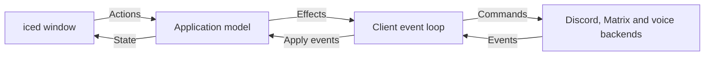

# Application core and client UI

Yapfast's Cargo workspace has six packages; five make up the one process. The root `yapfast`
package is the executable: the command-line entry point and what the desktop
gives the window (the tray, notifications, links, keybinds, updates).
[`crates/yapfast-core`](../crates/yapfast-core) holds application behavior and the
native Matrix, Discord and voice backend.
[`crates/yapfast-discord`](../crates/yapfast-discord) holds the Discord protocol:
login, the gateway, the HTTP API and voice.
[`crates/yapfast-iced`](../crates/yapfast-iced) is the window, written in
[iced](https://iced.rs); see [the client](client/README.md).
[`crates/yapfast-iced-kit`](../crates/yapfast-iced-kit) is what its screens are
built from (the theme, controls, forms, dialog frames and its own widgets),
knowing nothing of the core.
[`testing/hosts`](../testing/hosts) builds the stand-ins `scripts/ui-session`
runs beside Yapfast: a tray and a recorder of its test display.

## Where things live

The window is `crates/yapfast-iced/src`, one module or folder per area
(`timeline/`, `message/`, `composer.rs`, `sidebar/`, `call/`, `settings/`
and so on; [how the client is built](client/structure.md) lists them), with
its tests in `tests/`. The menus a right click opens are in `menus.rs`,
`place_menus.rs` and `person_menu.rs`. The widgets, fonts and icons are
`crates/yapfast-iced-kit`. The root crate's `src/` holds `main.rs` and one
module per part of the desktop, which `desktop.rs` hands the window as its
`Desktop`.

The Discord connection is `crates/yapfast-discord/src/service.rs`, with its
parts in `service/`: `tracker.rs` keeps the account's servers, voice, DMs,
friends and settings current from gateway events, `publisher.rs` sends out
snapshots of it, and `member_lists.rs` keeps the member lists beside
channels. The service publishes an `Arc<Snapshot>` on a watch channel;
`crates/yapfast-core/src/discord_text.rs` receives it and passes it on as
`Event::Discord`, which `show_snapshot` in `application/discord_account.rs`
applies. `discord.rs` turns a snapshot into rooms and servers, making again
only those that changed.

Media in `crates/yapfast-core/src/`: `playback.rs` is the video playing in
the conversation view, which `video_player.rs` plays in the stream worker.
`stream_worker.rs` runs Go Live and video playback in a child process,
`yapfast --stream-worker`, so their memory goes when they stop. `video.rs`
reads video files, `encode.rs` encodes Go Live and the camera, and
`decode.rs` decodes a watched stream, each through C in `native/*.c`.
`audio_io.rs` and `audio_io/` are Yapfast's own sound devices.

`vendor/` holds iced's two renderers and cosmic-text, patched, webrtc-sys,
matrix-rtc-livekit, davey and tungstenite, plus x264's and FFmpeg's C source; see
[dependency sources](building.md#dependency-sources). LiveKit itself comes
from crates.io, not `vendor/`.

Two experiments stay in the tree: `experiment.rs` behind `--call-experiment`
and `voice_demo.rs` behind `--voice-demo`, both in yapfast-core and
dispatched from `src/main.rs`.

## Shared application behavior

[`application.rs`](../crates/yapfast-core/src/application.rs) owns navigation,
remembered channels, per-room drafts, replies, the message being edited, delete confirmation,
selected timelines, account and trust status, history loading, call controls and
voice-switch confirmation. The backend saves drafts in the encrypted session
store and sends through the SDK's persistent send queue, which owns retries.
Its local preview uses the same model and emits no network effects.

A client sends an `Action` to `Application::dispatch` and applies backend events
with `Application::apply`. These methods return effects for starting a session
or sending a backend command. `AppState` supplies ordinary Rust data for rendering,
including shared timeline storage through `Arc<Vec<Arc<ChatMessage>>>`, whose
rows a backend sends again unchanged when they didn't change. Its rooms and
servers are `Arc`s shared with each network's own lists, which keep a room
or server while it stays the same. `dispatch`
routes each action to a method in the module for its area, under
[`application/`](../crates/yapfast-core/src/application); the `mod` lines at
the top of `application.rs` list them. For example, `compose` holds the
composer, `aside` shows a Discord thread beside the open channel, and
`places` builds the menus of Discord servers, categories and channels.

The window ([`crates/yapfast-iced`](../crates/yapfast-iced)) owns input widgets,
password masking, focus, filtering, scroll position, list virtualization,
device selectors, window state, theme and icons. It holds the application in
its `Client` (`client.rs`), and after each batch of the backend's events
`sync.rs` takes in only what changed. A programmatic composer update uses the
new room's draft, so it cannot overwrite that draft with the previous room's
text.

Timeline rows retain text, attachment dimensions and message actions for all
loaded history. The timeline ends at the newest message, or is a window of
older messages that doesn't reach it (`AppState::detached`): `Action::Jump`
to a message that isn't loaded sends `Command::Around`, and the backend
shows the messages around it in place of the timeline, answering with
`Event::HistoryLoaded` before the window's `Event::Timeline`, so the
application can leave timelines meant for what showed before.
`Command::Earlier` and `Command::Later` add a page at either end, and each
`Event::HistoryLoaded` says whether the timeline reaches the room's first
message and its newest. `Command::Present` shows the newest again: Discord
keeps them beside the window, following live events, and Matrix rebuilds
its live timeline from the SDK's event cache. Neither loads them again. The UI reports visible item ids, with six rows of margin on
each side, through `Action::VisibleMessages` and `Command::VisibleMessages`.
Discord and Matrix download and decode previews for those items and release
distant decoded handles. A report goes out at once after a quiet spell and at most every 50 ms
while the view moves; reports reject old rooms,
and refresh when temporary message ids become server event ids even if the
row count stays the same. Discord's recent channels share an 8 MiB LRU cache
of decoded preview pixels; closing a channel clears its own preview handles
and the remembered application's handles. Active rows can hold additional
images outside the cache budget.

Virtualized server, DM, member, friend and message rows carry avatar URLs.
The window asks for a picture as a row that shows it is built
(`pictures.rs` in the client), and missing pictures are fetched in one batch.
yapfast-core decodes pictures into the renderer's own format
(`set_pixel_buffers`), so the window draws a picture from the core's pixels
rather than a copy. A one-second timer releases animation decoders and their
last frames after they stop being used, and stops itself when no decoders
need checking.

## How a UI change flows through the code

A visible change usually touches each of these steps:

1. **View.** Each area of the window is a module of `crates/yapfast-iced/src`
   with a free `view` function that draws it from the state (`AppState`,
   through `Ctx`) with the kit's widgets. iced builds the whole view again
   after every message, so a view only reads. Colours come from the theme
   (`Ctx::theme`). [How the client is built](client/structure.md) has the
   rules, and [adding a screen](client/structure.md#adding-a-screen) the
   steps for a new one.
2. **Input.** A widget's press, text or key becomes the area's `Event`, which
   is one variant of the app's `Message` (`app/message.rs`). `App::update`
   hands it to the area's `update` function.
3. **Application.** The area's `update` turns the event into an `Action` and
   dispatches it through the `Client`, which calls `Application::dispatch` and
   executes the returned effects. `Action` and `dispatch` are in
   `crates/yapfast-core/src/application.rs`, which routes each action to the
   module for its area in `crates/yapfast-core/src/application/`.
4. **Backend.** An `Effect::Backend(Command)` goes through `Backend::send` to
   the chat actor in `crates/yapfast-core/src/chat.rs`, which routes it to the
   network its room id names, or to voice. Matrix lives
   in `matrix_chat.rs` and `matrix_voice.rs`; Discord in `discord.rs`,
   `discord_text.rs` with its modules in `discord_text/`, `discord_voice.rs`,
   `discord_audio.rs` and `discord_link.rs`, all under
   `crates/yapfast-core/src/`. The Discord protocol itself is in
   `crates/yapfast-discord`, and `src/event.rs` there names the gateway's
   events. Backend events come back through `Application::apply`.
5. **State to window.** After a dispatch or a batch of events, `sync.rs`
   takes in what changed (the core counts changes to its rooms, servers and
   people lists, and shares messages by `Arc`), and the next view draws it.

Yapfast's own sound outside LiveKit's calls goes through
[`audio_io.rs`](../crates/yapfast-core/src/audio_io.rs): Discord voice, the input
meter, ringing, Yapfast's sounds, a watched stream's or a video's sound, and what
other applications play for Go Live. It opens a microphone or speakers by the
device id LiveKit lists, `None` being the system's default, and reads or writes
on the caller's thread in the caller's own buffers. On Linux that's
PulseAudio, or PipeWire's PulseAudio server; on Windows it's WASAPI in shared
mode, with WebRTC's device ids naming its endpoints.

Each `ChatRoom` carries its `network` and its `capabilities`, such as
whether its messages can be forwarded or its channels sit under
categories, which its backend sets
([`network.rs`](../crates/yapfast-core/src/network.rs)). The application and
the UI ask a room for these rather than reading its id; code that holds
only an id reads its network with `Network::of`.

## Native backend ownership

[`backend.rs`](../crates/yapfast-core/src/backend.rs) starts the chat actor and owns
its command sender, background task and runtime reference. The client retains
this handle for the session, independently of the selected text or voice channel.
Incoming events arrive through a Tokio receiver, so each UI framework can choose
how to wake its event loop.

The window takes that receiver's events in batches, as messages on iced's own
loop. No timer polls the network or redraws an idle window. The client keeps
one backend across navigation and drops its event receiver before releasing
the backend.

The actor owns one Matrix session and its sync service. The voice controller
leases that same client and encrypted store. Encryption and device trust checks
remain authoritative in the backend. Explicit logout stops voice and sync before
revoking the session; failed logout retains the account. Dropping the backend on
the client thread cancels its work without revoking saved credentials.

The core has no UI-framework dependency. Its native services still
depend on Tokio, SQLite, OS credential storage and libwebrtc. A browser client
will need platform implementations for those services. This split shares app
behavior without claiming the native backend already runs on the web or Android.

## Adding another native UI

1. Depend on `yapfast-core` and render its `AppState`.
2. Dispatch user actions and execute returned effects. For a start effect, retain
   the `Backend` handle and receive its events. For a command effect, call `send`.
3. Feed rejected commands to `Application::backend_failed` and closed event streams
   to `Application::stopped`, then render the updated state.
4. Keep widget-specific work in the client. `selection_version` identifies a room
   change or re-selection; `reset_version` identifies a return to sign-in. Compare
   timeline `Arc` identities to detect timeline replacement without copying it.

Framework experiments can use the shared preview first and connect to the same
native backend afterward. They must preserve the model's behavior rather than
implement their own drafts, send handling or voice lifecycle.

## Checks and packaging

`scripts/check` checks the whole workspace, including the headless build
(`--no-default-features --features matrix,discord`); see
[building](building.md#checks). Ignored chat and voice tests belong to
`yapfast-core`, so select them with `cargo test -p yapfast-core`.

Library tests keep disposable fixtures under the workspace's
ignored `.local` directory even though Cargo runs them from the crate directory.
Windows runtime checks are in the [Windows guide](windows-beta.md).
