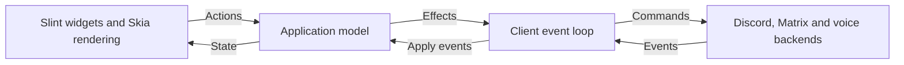

# Application core and client UI

Yapfast's Cargo workspace has seven packages: the executable and the crates that
build into its process, plus the two that make up the plugin helper, a binary of
its own. The root `yapfast` package is the executable: the Slint adapter and the
command-line entry point.
[`crates/yapfast-core`](../crates/yapfast-core) holds application behavior and the
native Matrix, Discord and voice backend.
[`crates/yapfast-discord`](../crates/yapfast-discord) holds the Discord protocol:
login, the gateway, the HTTP API and voice. [`crates/yapfast-ui`](../crates/yapfast-ui)
compiles `ui/yapfast.slint` and the files it imports in its `build.rs`, so editing
any `.slint` file rebuilds only that crate, and in a
[live-preview build](building.md#seeing-the-app) nothing at all.
[`crates/feature-union`](../crates/feature-union) holds no code; `scripts/check`
uses it (see [building](building.md#checks)).
[`crates/yapfast-plugin-api`](../crates/yapfast-plugin-api) holds the wire types
Yapfast and the plugin helper both build, and
[`crates/yapfast-plugin-host`](../crates/yapfast-plugin-host) is the seventh: it
builds `yapfast-plugins`, a process that runs plugins and nothing else, as
[plugins](plugins/README.md) describes.

## Where things live

`crates/yapfast-ui` holds only the Slint build: `build.rs` compiles
`ui/yapfast.slint` and `src/lib.rs` includes the generated code. It is a
path dependency outside the Cargo workspace, so Clippy doesn't lint that
code. The Slint files themselves are `ui/*.slint`, and the Rust that fills
them is `src/ui.rs` and `src/ui/`. The menus a right click opens are in
`src/ui/menus.rs`.

The Discord connection is `crates/yapfast-discord/src/service.rs`, with its
parts in `service/`: `tracker.rs` keeps the account's servers, voice, DMs,
friends and settings current from gateway events, `publisher.rs` sends out
snapshots of it, and `member_lists.rs` keeps the member lists beside
channels. The service publishes an `Arc<Snapshot>` on a watch channel;
`crates/yapfast-core/src/discord_text.rs` receives it and passes it on as
`Event::Discord`, which `show_snapshot` in `application/discord_account.rs`
applies. `discord.rs` turns a snapshot into rooms and servers, making again
only those that changed.

Media in `crates/yapfast-core/src/`: `playback.rs` is the video playing in
the conversation view, which `video_player.rs` plays in the stream worker.
`stream_worker.rs` runs Go Live and video playback in a child process,
`yapfast --stream-worker`, so their memory goes when they stop. `video.rs`
reads video files, `encode.rs` encodes Go Live and the camera, and
`decode.rs` decodes a watched stream, each through C in `native/*.c`.
`audio_io.rs` and `audio_io/` are Yapfast's own sound devices.

`vendor/` holds patched Slint, webrtc-sys, matrix-rtc-livekit, davey and
tungstenite, plus x264's and FFmpeg's C source; see
[dependency sources](building.md#dependency-sources). LiveKit itself comes
from crates.io, not `vendor/`.

Plugins, behind the `plugins` feature, are in
`crates/yapfast-core/src/plugins.rs` and `plugins/`, `src/ui/plugins.rs` and
`ui/plugins.slint`; see [plugins](plugins.md).

Two experiments stay in the tree: `experiment.rs` behind `--call-experiment`
and `voice_demo.rs` behind `--voice-demo`, both in yapfast-core and
dispatched from `src/main.rs`.

## Shared application behavior

[`application.rs`](../crates/yapfast-core/src/application.rs) owns navigation,
remembered channels, per-room drafts, reply and edit modes, delete confirmation,
selected timelines, account and trust status, history loading, call controls and
voice-switch confirmation. The backend saves drafts in the encrypted session
store and sends through the SDK's persistent send queue, which owns retries.
Its local preview uses the same model and emits no network effects.

A client sends an `Action` to `Application::dispatch` and applies backend events
with `Application::apply`. These methods return effects for starting a session
or sending a backend command. `AppState` supplies ordinary Rust data for rendering,
including shared timeline storage through `Arc<Vec<Arc<ChatMessage>>>`, whose
rows a backend sends again unchanged when they didn't change. Its rooms and
servers are `Arc`s shared with each network's own lists, which keep a room
or server while it stays the same. `dispatch`
routes each action to a method in the module for its area, under
[`application/`](../crates/yapfast-core/src/application); the `mod` lines at
the top of `application.rs` list them. For example, `compose` holds the
composer, `aside` shows a Discord thread beside the open channel, and
`places` builds the menus of Discord servers, categories and channels.

The Slint adapter in [`src/ui.rs`](../src/ui.rs) and [`src/ui/`](../src/ui), with
the interface in [`ui/*.slint`](../ui), owns input widgets, password masking,
focus, filtering, scroll position, list virtualization, device selectors, window
state, theme and icons. `Adapter::refresh`, in
[`src/ui/refresh.rs`](../src/ui/refresh.rs), shows the application's state one
area at a time. `ui/yapfast.slint` holds the window and imports its parts
from the files beside it. The adapter updates widgets after model changes. A
programmatic composer update uses the new room's draft, so it cannot overwrite that draft with
the previous room's text.

Timeline rows retain text, attachment dimensions and message actions for all
loaded history. The timeline ends at the newest message, or is a window of
older messages that doesn't reach it (`AppState::detached`): `Action::Jump`
to a message that isn't loaded sends `Command::Around`, and the backend
shows the messages around it in place of the timeline, answering with
`Event::HistoryLoaded` before the window's `Event::Timeline`, so the
application can leave timelines meant for what showed before.
`Command::Earlier` and `Command::Later` add a page at either end, and each
`Event::HistoryLoaded` says whether the timeline reaches the room's first
message and its newest. `Command::Present` shows the newest again: Discord
keeps them beside the window, following live events, and Matrix rebuilds
its live timeline from the SDK's event cache. Neither loads them again. The UI reports visible item ids, with six rows of margin on
each side, through `Action::VisibleMessages` and `Command::VisibleMessages`.
Discord and Matrix download and decode previews for those items and release
distant decoded handles. A report goes out at once after a quiet spell and at most every 50 ms
while the view moves; reports reject old rooms,
and refresh when temporary message ids become server event ids even if the
row count stays the same. Discord's recent channels share an 8 MiB LRU cache
of decoded preview pixels; closing a channel clears its own preview handles
and the remembered application's handles. Active rows can hold additional
images outside the cache budget.

Virtualized server, DM, member, friend and message rows carry avatar URLs.
`PictureStore` resolves them only when Slint instantiates their components,
queues missing pictures for one batch, and updates visible bindings when
pictures arrive. Each binding reads the revision of one of 32 slots, by a
hash of its address, and a picture that comes, changes or goes moves only
its slot's revision: the rest of the window's pictures keep their drawn
images and aren't painted again. Its source registry holds weak pointers. The UI has
yapfast-core decode pictures into Slint's pixel buffers (`set_pixel_buffers`), so
a Slint image of a picture shares its pixels rather than copying them.
Converted avatars and gallery previews share an 8 MiB Slint image cache;
profiles and call controls still request their visible pictures directly. A one-second timer
releases animation decoders and their last frames after they stop being used,
and stops itself when no decoders need checking.

## How a UI change flows through the code

A visible change usually touches each of these steps:

1. **Slint.** A component in `ui/<area>.slint` declares a property or callback.
   Rust sees only `YapfastWindow` in `ui/yapfast.slint` and the structs and globals
   it exports, so `YapfastWindow` declares a matching property or callback and
   binds it to the component. Colours are the exception: components read the
   `Theme` global, which `src/ui/theme.rs` sets whole. The areas are the files
   in `ui/*.slint`, such as `composer`, `messages` and `server_settings`.
2. **State to window.** `Adapter::refresh` calls one `show_<area>` method in
   `src/ui/refresh.rs` per area (grep `fn show_` there), such as
   `show_composer` or `show_messages`, which sets the window's properties from
   `AppState`. Message rows are built in `src/ui/messages.rs`, profile rows in `src/ui/profile.rs`
   and pictures in `src/ui/pictures.rs`.
3. **Input.** `bind_callbacks` in `src/ui/callbacks.rs` registers an `on_*`
   handler for each window callback. Most turn the input into an `Action` and
   pass it to `Adapter::action` in `src/ui.rs`.
4. **Application.** `Adapter::action` calls `Application::dispatch`, executes
   the returned effects, then refreshes the window. A composer keystroke
   (`SetDraft` or `MentionQuery`) refreshes only the composer. A backend event
   shows only what it can change: who's typing shows only the composer, and
   the call, with who's speaking, only the call's views (`Reach` in
   `src/ui/refresh.rs`). The sidebar is built again only once what it shows
   changed. `Action` and
   `dispatch` are in `crates/yapfast-core/src/application.rs`, which routes each
   action to the module for its area in `crates/yapfast-core/src/application/`.
5. **Backend.** An `Effect::Backend(Command)` goes through `Backend::send` to
   the chat actor in `crates/yapfast-core/src/chat.rs`, which routes it to the
   network its room id names, or to voice. Matrix lives
   in `matrix_chat.rs` and `matrix_voice.rs`; Discord in `discord.rs`,
   `discord_text.rs` with its modules in `discord_text/`, `discord_voice.rs`,
   `discord_audio.rs` and `discord_link.rs`, all under
   `crates/yapfast-core/src/`. The Discord protocol itself is in
   `crates/yapfast-discord`, and `src/event.rs` there names the gateway's
   events. Backend events come back through `Application::apply`.

Yapfast's own sound outside LiveKit's calls goes through
[`audio_io.rs`](../crates/yapfast-core/src/audio_io.rs): Discord voice, the input
meter, ringing, Yapfast's sounds, a watched stream's or a video's sound, and what
other applications play for Go Live. It opens a microphone or speakers by the
device id LiveKit lists, `None` being the system's default, and reads or writes
on the caller's thread in the caller's own buffers. On Linux that's
PulseAudio, or PipeWire's PulseAudio server; on Windows it's WASAPI in shared
mode, with WebRTC's device ids naming its endpoints.

Each `ChatRoom` carries its `network` and its `capabilities`, such as
whether its messages can be forwarded or its channels sit under
categories, which its backend sets
([`network.rs`](../crates/yapfast-core/src/network.rs)). The application and
the UI ask a room for these rather than reading its id; code that holds
only an id reads its network with `Network::of`.

## Plugins

Plugins are behind the `plugins` Cargo feature, and their code sits on both
sides of a pipe. [`yapfast-plugin-api`](../crates/yapfast-plugin-api) is the
contract: the frames, the payloads a guest's exports and imports carry, the
manifest, the capabilities and the limits, with `serde` and no other dependency
because both processes build it. [`yapfast-plugin-host`](../crates/yapfast-plugin-host)
is the helper: `host.rs` is its main loop, `scheduler.rs` its mailboxes, lanes and
deadlines, `runtime.rs` the Extism and wasmtime side, `pipe.rs` the frames on
stdin and stdout, `logging.rs` the rule that the helper's own lines go to stderr,
and `fetch/` the git install. The crate is deliberately outside `cargo build`'s
default members, because it links Extism, wasmtime and `gix` for a process that
only runs while a plugin does.

The parent's half is `crates/yapfast-core/src/plugins/`: `bridge.rs` owns the
helper's pipes as one Tokio task and turns frames into events,
`registry.rs` holds what is enabled, `permissions.rs` checks each call against
the manifest and `grants.rs` keeps the hosts a person allowed, `network.rs` is
the gate a fetch goes through, `store.rs` reads the content-addressed store and
its lock file, and `spawn.rs` starts the helper and counts its crashes. The
application's side is `crates/yapfast-core/src/application/plugins.rs`, and the
interface's is `src/ui/plugins.rs` with `ui/plugins.slint`.

Nothing of it runs while no plugin is enabled: `AppState` carries no plugin
state, the helper process doesn't exist, and the taps in the send path, the event
path and the menus cost one check each.

A change to what a plugin can do usually touches each of these steps:

1. **Contract.** A new method, event kind or payload field goes in
   `yapfast-plugin-api`. Adding one keeps `API_VERSION`; changing what an
   existing one means raises it. See [the ABI](plugins/abi.md).
2. **Parent.** A host method is answered in `plugins/bridge.rs`, which checks the
   capability in `plugins/permissions.rs` and, for a request, the host in
   `plugins/network.rs` before doing any work.
3. **Helper.** What the guest's call becomes in the sandbox is
   `yapfast-plugin-host`'s `runtime.rs`, and when it runs is the scheduler's.
4. **Application.** An `Action` goes to `application/plugins.rs`, which decides
   what the effect is and hands it to the bridge; the answer comes back as an
   event, so a hook that looks synchronous is held in the application rather
   than in a thread.
5. **Interface.** Rows a plugin contributes are models in `src/ui/plugins.rs`,
   drawn by precompiled components in `ui/plugins.slint`: a plugin sends data and
   never a Slint element, since the interface is compiled ahead of time. The
   consent dialog's lines are the manifest's capabilities, in the order
   `Capability::ALL` gives them, so the dialog and the plugin's page can't
   disagree.

The pages under [docs/plugins](plugins/README.md) describe the manifest, the ABI,
the permissions, the helper and how to write and test a plugin.

## Native backend ownership

[`backend.rs`](../crates/yapfast-core/src/backend.rs) starts the chat actor and owns
its command sender, background task and runtime reference. The client retains
this handle for the session, independently of the selected text or voice channel.
Incoming events arrive through a Tokio receiver, so each UI framework can choose
how to wake its event loop.

Slint waits asynchronously on that receiver and updates presentation on its UI
thread. No timer polls the network or redraws an idle window. The adapter retains
one backend across navigation and cancels its event receiver before releasing
the backend. Widget models update changed rows instead of replacing every list
on voice or sync events.

The actor owns one Matrix session and its sync service. The voice controller
leases that same client and encrypted store. Encryption and device trust checks
remain authoritative in the backend. Explicit logout stops voice and sync before
revoking the session; failed logout retains the account. Dropping the backend on
the client thread cancels its work without revoking saved credentials.

The core has no UI-framework dependency. Its native services still
depend on Tokio, SQLite, OS credential storage and libwebrtc. A browser client
will need platform implementations for those services. This split shares app
behavior without claiming the native backend already runs on the web or Android.

## The plugin helper

`yapfast-plugins` is a second executable, built from
[`crates/yapfast-plugin-host`](../crates/yapfast-plugin-host). Plugins run in it
rather than in Yapfast's process, so wasmtime, Cranelift and a guest's memory are
not Yapfast's to carry; [plugins](plugins/README.md) has the lifecycle and the
reasoning behind the split.

Inside, the pipe owns the frames, the scheduler owns when and in what order a
plugin runs, and `runtime` is Extism behind both. A module's file is checked for
the `\0asm` magic, version 1 and its imports and exports before it is compiled.
The frames, envelopes and manifest are in
[`crates/yapfast-plugin-api`](../crates/yapfast-plugin-api), which both
processes build; [the ABI](plugins/abi.md) describes them.

The helper links Extism and wasmtime and is not one of the default members, so
an everyday workspace build links neither; `scripts/check` has steps of its own
for it and for `yapfast-core` with the `plugins` feature.

`crates/yapfast-core/src/plugins/` is the parent's half: the bridge that starts
the helper and answers a guest's calls, the registry, the store, permissions and
the network gate. The interface's half is not written yet, so no settings page
lists plugins and nothing calls `Application::open_plugins`; see
[what isn't wired](plugins/README.md#what-isnt-wired-yet).

## Adding another native UI

1. Depend on `yapfast-core` and render its `AppState`.
2. Dispatch user actions and execute returned effects. For a start effect, retain
   the `Backend` handle and receive its events. For a command effect, call `send`.
3. Feed rejected commands to `Application::backend_failed` and closed event streams
   to `Application::stopped`, then render the updated state.
4. Keep widget-specific work in the client. `selection_version` identifies a room
   change or re-selection; `reset_version` identifies a return to sign-in. Compare
   timeline `Arc` identities to detect timeline replacement without copying it.

Framework experiments can use the shared preview first and connect to the same
native backend afterward. They must preserve the model's behavior rather than
implement their own drafts, send handling or voice lifecycle.

## Checks and packaging

`scripts/check` checks the whole workspace, including the headless build
(`--no-default-features --features matrix,discord`), and then builds and tests
the plugin helper with Extism on, assembles its fixtures and runs the
measurement harness's tests; see [building](building.md#checks). Ignored chat
and voice tests belong to `yapfast-core`, so select them with
`cargo test -p yapfast-core`.

Library tests keep disposable fixtures under the workspace's
ignored `.local` directory even though Cargo runs them from the crate directory.
Windows runtime checks are in the [Windows guide](windows-beta.md).
