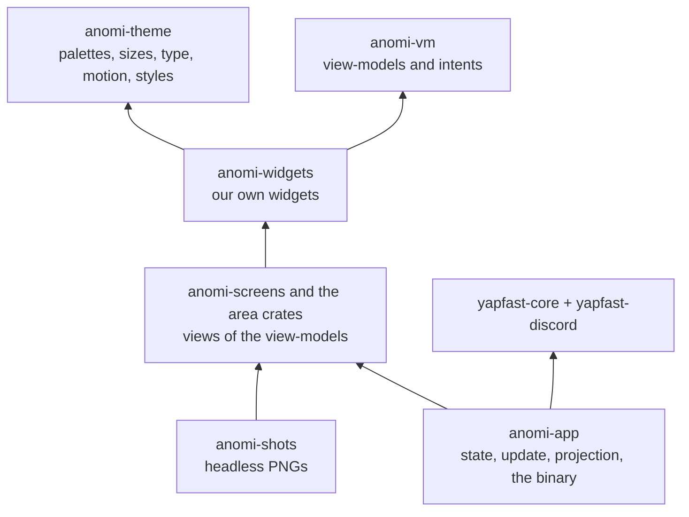
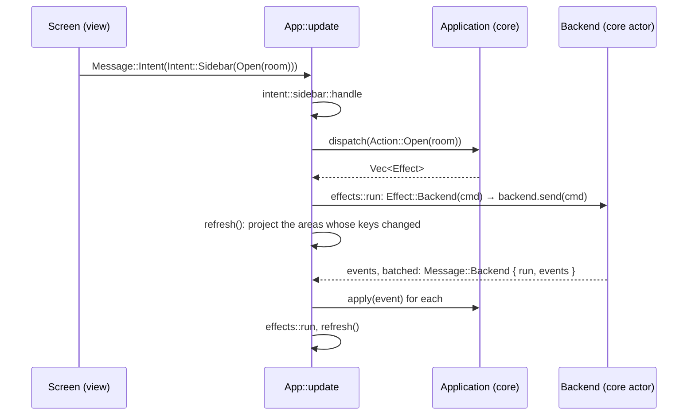

# The iced interface

Anomi is getting a second interface, written with [iced](https://github.com/iced-rs/iced)
beside the Slint one, on the same core: `crates/yapfast-core` and
`crates/yapfast-discord` stay as upstream has them, so upstream's fixes keep
merging. The iced interface grows screen by screen until it does everything
the Slint one does; then the Slint one goes. This page is the architecture
for the agents who write it (writers) and those who check it (reviewers).
The iced API at the pinned commit is in [iced-notes.md](iced-notes.md); the
work, task by task, is in [tasks.md](tasks.md).

Run it against the fake Discord, as the Slint app runs:

```sh
scripts/ui-session start --discord --anomi --size 1400x860
scripts/ui-session do 'click 150 281' 'theme catppuccin-latte' 'language en' 'shot dm'
```

## Crates and layers



| Crate | Holds | Depends on | Who edits it |
| --- | --- | --- | --- |
| `anomi-theme` | the twelve palettes (`builtin/`), `Theme` and every built-in widget's style catalog (`catalog/`), `metrics`, `typography`, `motion`, `fonts`, the `View` and `Element` types | iced | writers |
| `anomi-vm` | per area: the view-model a screen draws and the `Intent` it sends; `kind` for shared vocabulary; `fixtures` (feature) for samples | iced (for `image::Handle`) | writers |
| `anomi-widgets` | one module per widget: compositions (`avatar`, `badge`) and widgets of our own (`rail_item`, `picture`) | theme, vm | writers; the hard widgets are Opus tasks |
| `anomi-screens` | the window (`shell`) and its areas, one folder per area, one module per component; `shots` (feature) lists what `anomi-shots` renders | theme, widgets, vm, yapfast-lang | writers |
| `anomi-chat`, `anomi-people`, `anomi-voice`, `anomi-settings` | the larger areas, split off so each compiles on its own (made by task F01) | as `anomi-screens` | writers |
| `anomi-shots` | renders each screen from its fixture to PNG, no display | screens | reviewers run it |
| `anomi-app` | `App` (the program's state), `update`, the projection of the core's `AppState` (`project/`), intents to `Action`s (`intent/`), effects to tasks (`effects`), the backend, `layout.json`, the `anomi` binary | everything above and yapfast-core with `discord` | Opus integration tasks, never writers |

The rule that makes this work: **nothing a writer touches depends on
yapfast-core**. The core's `livekit` and `webrtc-sys` aren't optional and
its `discord` feature builds x264, FFmpeg and thorvg; any crate above it pays
for that in every `cargo check`. So screens draw view-models, plain data the
app fills from the core, as `src/ui/refresh.rs` fills the Slint window
today. A writer's check builds iced and nothing native.

Every crate takes iced from one entry in the root `Cargo.toml`
(`[workspace.dependencies] iced`), so the whole graph builds once with one
feature set; never give a crate iced features of its own.

## Modules, files and names

- **One folder per area, one module per component.** An area is a part of
  the window with its own Slint file: `rail`, `sidebar`, `conversation`,
  `composer`, `friends`, `voice`... The same area has the same name in
  `anomi-vm/src/<area>`, the screens crate's `src/<area>` and
  `anomi-app/src/{project,intent}/<area>`.
- **Name things after the Slint side**, in Rust's case: `RailItem` becomes
  `rail_item::RailItem`, the struct `RoomRow` becomes `sidebar::DmRow` or
  `ChannelRow` as it splits. Each module's doc names the Slint component and
  the glue (`file:line`) it ports, so a reviewer can hold them side by side.
- **400 lines a file at most**, tests included; `scripts/check-iced` fails
  a longer one. Split by component, not by kind of code.
- **No colour, size or duration literal in a screen**: they come from
  `anomi-theme` (`theme.palette()`, `metrics`, `typography`, `motion`). A
  value one widget needs and nothing else may stay in that widget's module
  as a named constant with the Slint line it came from.
- Text the person reads goes through `tr!` (see [Translation](#translation)).
- Every module starts with `use anomi_theme::prelude::*;`, which brings
  `View`, `Element`, `Theme`, `Motion` and iced's `Widget` trait (for
  `.boxed()` and `.map()`).

### Shared files

Writers work in parallel, each in the files its task owns
([tasks.md](tasks.md)), so nothing two areas need may live in one file that
both would edit:

- **Parent modules come first.** Task F01 creates every module a task
  names, empty, with its `mod` line in the parent (`lib.rs`, `mod.rs`), the
  `Vm` field and the `Intent` variant: an area made of parts (the sidebar's
  DMs, channels and server header; the composer's suggestions and
  commands) has one `Intent` enum per part, nested in its parent's. A task
  fills its own files and adds no line elsewhere.
- **What only one area uses stays in that area.** A size, a colour
  derived from the palette, a button look: a named constant or a style
  function in the area's module, with the Slint line it came from.
  `anomi-theme` (`metrics`, `catalog`, `palette`) and `anomi_vm::kind` hold
  what several areas share; they change only through the tasks that own
  them (F02, F14), and a writer who needs something there says so in the
  review rather than editing it.
- **Fixtures, shots and tests go with the view-model.** A task owning
  `anomi-vm/src/<area>.rs` also owns `anomi-vm/src/fixtures/<area>.rs`,
  the `shots()` function of its screen module (each crate's `shots.rs`
  only collects them; F01 writes that list) and its crate's
  `tests/<area>.rs`.
- **The integration tasks share `anomi-app`'s spine** (`app.rs`,
  `message.rs`, `effects/mod.rs`, `project/mod.rs`, `intent/mod.rs`,
  `project/rows.rs`): they run one at a time in one worktree, so each adds
  its arms there in turn.

## From a click to the core and back



- **Intent.** A screen asks with its area's `Intent` (in `anomi-vm`), wrapped
  in `anomi_vm::Intent`, mapped by the shell into `Message::Intent`. Intents
  are `Clone`, `Debug` and `PartialEq`, so tests compare them.
- **update.** `intent/<area>.rs` handles each: a change to the view-model's
  own state (a search field's text, a panel's width, which popup is open)
  stays in the app and re-projects; anything the core decides becomes an
  `Action` through `App::dispatch`. The core's `Action`, `Event` and
  `Effect` aren't `Clone`, so they never travel in a message; events ride
  in [`Once`](../../crates/anomi-app/src/message.rs), taken in `update`.
- **Effects.** `effects::run` turns each `Effect` into a direct call or an
  iced `Task`: `Start` starts the backend, `Backend(cmd)` sends at once and
  hands a refused command to `backend_failed`, `ListDevices` will be
  `Task::perform` over the core's `spawn_blocking` (I18), notifications and
  sounds direct calls (I15), linking Discord an abortable task (I05).
- **Events.** The backend's Tokio receiver becomes a stream, `ready_chunks(256)`,
  run as one abortable `Task` per backend start, numbered by `run`; when it
  ends, `BackendClosed(run)` reaches `stopped()`. Each event of a batch
  applies and then runs its effects before the next applies, as the Slint
  app's `Adapter::apply` does; the areas refresh once per batch. A quiet
  backend wakes nothing. Dropping `App` drops the events task, then the
  backend, then the runtime, in that field order.
- **Back to the screens.** `App::refresh` calls each area's
  `project::<area>::show` with the core's `AppState` and the app's own
  `Layout` (settings the core doesn't keep, such as how calls are joined).
  Each keeps a key of its inputs (the core's change counters such as
  `list_changes` and `picture_changes`, the selection, the settings it
  reads, its own UI state) and returns at once when the key is the same;
  otherwise it rebuilds that area's view-model. A key must cover everything
  the rows read, or the area goes stale; a key too wide only costs time.
- **view.** `App::view` calls `anomi_screens::window(&vm, motion)` on every
  update, and iced lays the whole window out again after it: every batch
  of backend events, a game running or not, costs a view and a layout of
  everything shown (tiny-skia then redraws only what changed). So views
  borrow the view-model and build only what shows: lists that can be long
  (timeline, members, pickers) build only the rows near the viewport
  through the virtual list (task F07), and an area whose view-model didn't
  change can be wrapped in `iced::widget::lazy` over its `version`, as
  `Sidebar::version` is made for. Q03 measures a busy server behind a game.

## How a screen gets its data

1. The writer defines the area's view-model in `anomi-vm/src/<area>.rs`
   after the Slint structs it replaces (`MessageRow`, `RoomRow`...), keeping
   only what the screen draws, already formatted: text translated, counts as
   badges, times as text. Pictures are `iced::widget::image::Handle`s the
   app made from the core's pixels without a copy (`anomi-app/src/pictures.rs`).
2. Writes fixtures for it in `anomi-vm/src/fixtures` after the fake
   Discord's data, used by tests and shots.
3. Writes the view in the screens crate, from the view-model alone.
4. An Opus integration task writes `project/<area>.rs` (porting the
   `show_<area>` of `src/ui/refresh.rs`) and `intent/<area>.rs` (porting the
   area's `on_*` handlers in `src/ui/callbacks.rs`).

## Styling

`anomi_theme::Theme` is the theme type of every widget: a palette (the 37
tokens of `ui/theme.slint`) with its id and name. Each built-in widget's
`Catalog` is implemented for it in `anomi-theme/src/catalog/<widget>.rs`
with the look the interface wants by default, plus named styles several
places share (`catalog::button::primary`, `catalog::container::sidebar`).
A widget takes another look with `.style(|theme: &Theme, status| ...)`,
reading `theme.palette()`; derived colours (`menu()`, `composer()`,
`placeholder()`, `mention()`) are methods on `Palette`. A built-in widget
whose catalog isn't there yet doesn't compile with our `Theme`: add its
module (F02 adds the rest). Switching theme replaces `App::theme`; nothing
is rebuilt, as styles are read at draw time.

## Motion

The durations and curves of `ui/theme.slint` are `anomi_theme::motion`:
`QUICK` 120 ms, `SLIDE` 180, `LINGER` 400, `POPUP` 150, `DIALOG` 220, `LEAVE`
120, `ARRIVE` = `cubic-bezier(0.22, 1, 0.36, 1)`, `GLIDE` = ease-in-out.
`Motion { front, never, idle }` says whether anything may move; every
animation takes its duration from `motion.duration(token)` or
`motion.animation(...)`, which are zero while `still()`. An animation either
lives in the app's state, interpolated in `view` at the frame time from
`window::frames()` (subscribed only while it plays and the window is in
front), or in a widget's tree state, as `RailItem` keeps its pill: the widget
asks `shell.request_redraw()` on each `RedrawRequested` only while it plays,
and lands at once when `motion.still()`. Scrollables get
`.smooth_scroll(motion.playing())`. The settings' "never animate" sets
`never`; the window's focus sets `front`.

## The background rule

While the window isn't in front nothing ticks or redraws: the owner plays
games with this client open. Concretely:

- Subscriptions that tick (`time::every`, `window::frames()`) are returned
  only while `motion.front` and something on screen needs them; a clock is
  right again the moment the window comes back. Test it with
  `subscription().units()`.
- Widgets request frames only while an animation plays, and none while
  `still`.
- Backend events still update the window, once each, as Slint did.
- Measured on the skeleton under `scripts/ui-session`: 0 CPU and 0 wakeups
  a second on the main thread, in front and behind another window; the
  only thread that wakes is the test session's control-file reader, which
  exists only on its private display.

## Translation

The interface is Russian by default (`yapfast_lang::DEFAULT`); English and
Russian are `lang/en.po` and `lang/ru.po`, keyed by the English text; see
[translations](../translations.md). In a view, `tr!("Friends")` is a
`&'static str` that borrows into the widget; `trn!("{n} member", "{n}
members", count)` picks the plural; `yapfast_lang::text_in("Microphone",
"Mute")` takes a context. Reuse the Slint text where it exists (grep
`lang/ru.po`); a new text needs its entry in `ru.po`, and in `en.po` too if
it names the product. Text made in the projection is translated there and
made again when the language changes (`language::choose` forgets every
area's key). `scripts/check-translations` (run by `check-iced`) lists text
without a translation.

## Testing

- **View-model and projection logic**: plain unit tests in the module.
- **Screens**: `iced_test::Simulator` over a fixture, in the screens crate's
  `tests/`: click by text (`ui.click("Friends")`), type, collect
  `into_messages()` and compare intents; `ui.rebuild(view)` shows the next
  view-model. Tests choose no language, so text is the code's English. See
  `crates/anomi-screens/tests/shell.rs`.
- **Looks**: each area module has a `shots()` its crate's `shots.rs`
  collects; `anomi-shots` renders them at 1x (or `--scale 2`, `--language
  en`, `--only TEXT`) for review. Shots draw the window with no pointer:
  hover and pressed looks are checked in the app. Snapshot comparison
  (`Simulator::snapshot(...).matches_image(...)`) comes when a screen is
  accepted, so later changes show as diffs.
- **The app**: `cargo test --profile fast -p anomi-app` (reviewers).

## Checks and builds

| Who | Command | What it costs (measured, 32 threads) |
| --- | --- | --- |
| Writer | `scripts/check-iced` | fmt, 400-line limit, translations, `cargo check` and Clippy of the crates without the core: 2 s in a new worktree (it copies the main checkout's `target/debug` with reflinks), 0.8 s with nothing changed, 1.1-1.3 s after an edit; 9 s and 3.0-3.3 GiB at its peak in an empty target |
| Reviewer | `scripts/check-iced --review` | adds the task list's coverage and ownership, those crates' tests, Clippy and tests of `anomi-app`, the `anomi` binary (`fast` profile) and the shots: 15-19 s warm; the first app build in a target that has the Slint app's native builds took 52 s, in an empty one several minutes and 5-7 GiB |

- Always name packages: `cargo check -p anomi-screens`. A bare `cargo check`
  at the root builds the Slint app (`default-members`), 6-8 GiB.
- `scripts/check` (the Slint app's) leaves the `anomi-*` crates out, so the
  two never resolve each other's dependencies. Both find the crates by
  their folder's name, as the workspace does (`crates/anomi-*`): a new
  area crate needs no list edited.
- A fresh worktree for `anomi-app` builds the core's native code again
  (`vendor/` crates are keyed by path). Keep one long-lived integration
  worktree, run one cold build at a time, and set `LK_CUSTOM_WEBRTC` to an
  unpacked libwebrtc for every build in that worktree, or each new target
  downloads 659 MB.

## The review loop

1. A writer takes a task from [tasks.md](tasks.md), works only in the
   modules it owns, and runs `scripts/check-iced` until it passes. It never
   builds or runs the app.
2. A reviewer (Opus) runs `scripts/check-iced --review`, opens the task's
   shots beside its reference screenshots (`~/.cache/anomi-iced/golden`, see
   its `index.md`), and checks the acceptance list: layout to the pixel
   grid of the reference at 1x, text and translations, states (hover,
   selected, empty, loading), keyboard, and the background rule.
3. Then, once the integration task of the area is in, on the real backend:
   `scripts/ui-session start --discord --anomi`, the same clicks as the
   reference shot, and `scripts/measure-process` for idle CPU and wakeups.
4. Anything off goes back to the writer as a list: what, where (shot and
   coordinates or `file:line`), and what the reference shows. Repeat.

## Gaps of the pinned iced, and who closes them

| Gap | Where it's handled |
| --- | --- |
| No virtual list | F07, a list widget of our own |
| tiny-skia ignores an image's border radius | `anomi-widgets/src/picture.rs` covers the corners for now; F05 makes rounded copies |
| No pictures inside text | F08, a paragraph widget with placeholder glyphs |
| Selection only of built widgets | F09, a selection model over the list |
| No exit animations, no layer manager | F06 |
| No tray, Wayland file drops, monitor list | I14 and I15, porting `src/tray.rs`, `src/drop.rs`, `src/ui/placement.rs` |
| No accessibility | not planned at this pin (pop-os's fork has AccessKit) |
