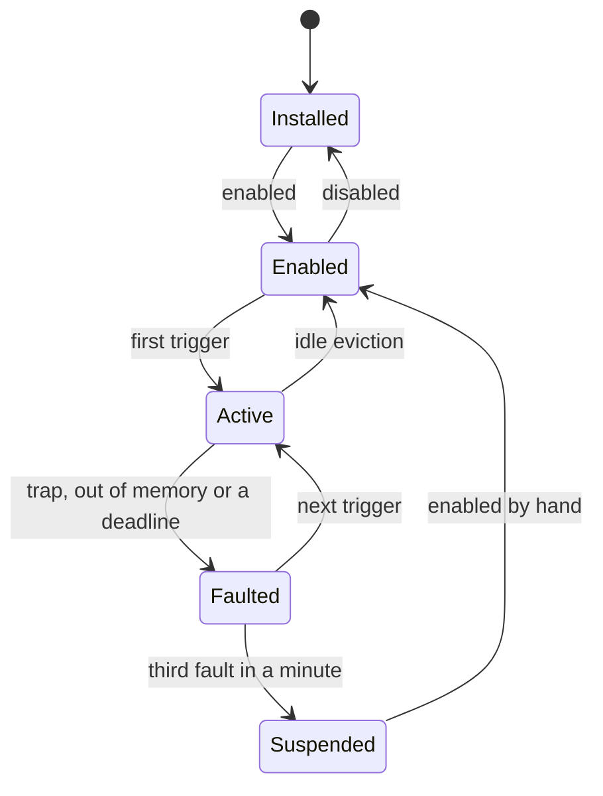

# Plugins

A plugin is a WebAssembly module and a manifest, `yapfast-plugin.json`, read
from a git repository and pinned there to one commit. Yapfast runs the module in
a helper process of its own, [`yapfast-plugins`](../../crates/yapfast-plugin-host),
and talks to it over a pipe of JSON frames. The helper holds no Discord token,
no Matrix session, no network stack and no filesystem; a guest asks Yapfast for
everything through one host function, and the parent answers it. What a plugin
may do is written in its manifest and agreed to at install, line by line:
[permissions](permissions.md).

Plugins are behind a Cargo feature, `plugins`, which is on in a plain build, and
the helper is a separate binary, so a build with the feature off links neither
wasmtime nor `gix`, and carries no plugin state.

## The documents here

| Reads like | Is |
| --- | --- |
| This one | What the plugin system is, what exists, and what doesn't yet |
| [`interface.md`](interface.md) | What a plugin changes in the interface: slots, widgets, named parts |
| [`settings.md`](settings.md) | A plugin's own settings: declaring them, the page that draws them |
| [`manifest.md`](manifest.md) | Every field of `yapfast-plugin.json` |
| [`abi.md`](abi.md) | The frames on the pipe, and the five exports a guest has |
| [`host.md`](host.md) | The helper: its threads, lanes, deadlines, faults and cache |
| [`permissions.md`](permissions.md) | Capabilities, consent, and the network gate |
| [`marketplace.md`](marketplace.md) | The registry repository: entries, icons, review and CI, browsing and updates |
| [`pdk.md`](pdk.md) | Writing a plugin, in Rust, C, Zig or AssemblyScript |
| [`testing.md`](testing.md) | Fixtures, fake Discord, and the measurements |

## The lifecycle

| State | What exists |
| --- | --- |
| Installed | Files under `store/`, and a line in the lock file. Nothing in memory. |
| Enabled | One registry entry in the parent: the manifest's contributions, its permissions and its subscription bits. The helper needn't be running. |
| Active | An instance in the helper, with the pages of memory its manifest asked for. |
| Faulted | It trapped, ran out of memory or missed a deadline. Its instance is gone and it is re-instantiated on its next trigger. |
| Suspended | Three faults in a minute. It stays off until the person enables it again. |



Enabling a plugin adds its registry entry and checks its dependencies; it starts
no process. A plugin names what wakes it, `startup`, `command`, `menu` or
`event:message_create` and the like, and is instantiated when one of those
happens. A person waiting on the result is what forces the two exceptions: a
plugin that intercepts outgoing messages is activated at startup, since the first
message must not go out before it is ready, and so is any plugin whose manifest
says `startup`.

**The helper exists only while an instance does.** The parent starts it on the
first activation, and it exits when the last instance is evicted, so wasmtime's
compile threads and a guest's linear memory never outlive the plugins that
needed them. With nothing enabled there is no helper, no thread and no timer:
`AppState` carries no plugin state at all, and the tap points in the send path,
the event path and the menus cost one check each. A plugin that has been
installed but never triggered costs its registry entry.

An instance is evicted after five minutes with no calls, at once when the window
closes to the tray, and when the helper's memory budget is full. A plugin holding
a timer or an open request isn't idle. The contract that follows, and that a
plugin's author has to write to: an instance may vanish between any two calls,
so anything that must survive goes in storage.

A run started with `--no-plugins` reads no plugin and starts no helper, which is
how someone gets their window back when a plugin has made it unusable; the next
run without the flag has its plugins again, since nothing was uninstalled.

## Keeping it small

A plugin system is a second runtime in the app, so most of the shape above is
there to keep its footprint at nothing while nobody uses it:

- **Copy once.** An event is serialized once, for the plugins that subscribed to
  it, and the helper hands the same bytes to each; an event nobody subscribed to
  is never serialized.
- **Filter before waking.** A subscription's filters — the room, the server,
  this account's own messages — are applied in the parent, so a plugin that
  didn't ask for something is never called with it.
- **Coalesce noise.** Typing, presence and speaking are opt-in and batched at a
  quarter of a second, so a burst arrives as one call carrying several events.
- **Share rather than clone.** A read answers from the `Arc<Snapshot>` and the
  `Arc<ChatMessage>` the app already holds, serialized while borrowed.
- **Evict.** An idle instance goes, and its linear memory with it, which
  WebAssembly can't give back on its own ([the lifecycle](#the-lifecycle)).
- **Stream to files.** A fetch is written to disk as it arrives, and the largest
  payload a plugin handles is capped rather than grown to fit ([the network
  gate](permissions.md#the-network-gate)).
- **Models only while visible.** The marketplace's catalog and the installed
  list exist while the page that draws them is open and not after, and a plugin
  that draws beside a row is asked about the rows on screen, never the channel.

The ceilings these add up to, and how each is measured, are in
[the measurements](../measurements/README.md#plugins).

## Decisions

A few questions have one answer each, and most of the rest of these pages
follow from them.

| Question | Answer |
| --- | --- |
| Where a plugin runs | In a helper process of its own, not in Yapfast ([the helper](host.md)) |
| What a manifest is | Strict JSON, read with the `serde_json` Yapfast already depends on ([the manifest](manifest.md)) |
| What a plugin may change | The plugin system's own surfaces. A plugin reaches Yapfast through the ABI; nothing patches Yapfast's code ([the ABI](abi.md)) |
| Sending with no one there | A capability of its own, whose warning says automated sending can get the account banned ([permissions](permissions.md#the-capabilities)) |
| Where the marketplace lives | A repository in the Yapfast organization, merged by a maintainer who read the source ([the marketplace](marketplace.md)) |
| What a listing promises | An OSI-approved license and a public `source` link; a URL install promises neither |
| Which network first | Discord's events. Every payload carries its network, so Matrix can follow without changing the ABI |
| Which language | Rust first: four PDKs ship in [`pdk/`](../../pdk), and a runtime carried inside a module costs its own memory ([writing a plugin](pdk.md)) |
| Which platforms | Linux and Windows. The macOS code paths are written and no macOS build ships: nobody has an Apple machine to test one on ([the README](../../README.md#macos)) |
| A hook that fails or runs late | The message goes as it was, unless the manifest asked to block it ([fail-open hooks](host.md#fail-open-hooks)) |
| Updates | Asked for, never taken: a URL install always, a marketplace one until someone builds the setting ([the marketplace](marketplace.md#what-is-not-there-yet)) |
| Installing from a URL | Open to anyone, with *Unreviewed source* said before anything runs ([permissions](permissions.md)) |
| Changing built-in UI | Named rows and parts, never a selector or a patch; consent, attribution and call state are not touchable ([the interface](interface.md)) |
| Recovering from an unusable interface | `--no-plugins` for one run ([the lifecycle](#the-lifecycle)) |

## What a plugin can add

Everything the interface shows before a plugin runs is in its manifest, so a
plugin that has never been activated still appears:

- commands in the composer's `/` list, with typed and required options;
- rows in a message, person, channel, server, role, emoji, sticker, image,
  stream, game, composer or attachment menu, with a closed set of `when`
  conditions and no expression language;
- buttons at the foot of the server rail and in a conversation's header;
- settings the plugin's page draws for it, as strings, numbers, sliders,
  switches, choices, lists of records and a widget tree it draws itself;
- named switches, `tweaks`, for parts of Yapfast that offer them: none does yet,
  so a point a manifest sets is refused as one this Yapfast doesn't have.

Once it is running it can subscribe to events and answer with data to draw: text
and controls beside a message, or inside a slot the interface offers. The
interface is compiled Slint, so a plugin adds no widget; it sends a tree and
precompiled components draw it.

A plugin can also talk to another: `plugin.call` runs one of the other's exports
and answers with what it returned, and `plugin.publish` hands bytes to whoever
subscribed to a topic with `plugin.subscribe`. A call follows the dependency
edges its manifest declares and no others, so two plugins can't call each other
in a loop and neither waits on something that waits on it; a call that would
come back around is refused with the chain that made the loop. A call wakes a
callee that was evicted, and an update of a plugin never leaves a plugin that
needs it running against nothing: the dependents are stopped in reverse
dependency order, the version is swapped with the plugin's handed-on state, and
they are started again. A call made during that moment waits rather than being
told the plugin isn't installed.

What it can't do is become Yapfast. A guest gets no Discord or Matrix token, no
raw authenticated request, no direct socket and no filesystem; network access is
one gated HTTPS fetch to the hosts its manifest names, and nothing else. It can't
answer with a shape the ABI doesn't define, and a host method this build doesn't
have answers `unsupported`, so a plugin feature-detects instead of failing to
load.

## Where the files live

Everything is in the data directory (the one `--data-dir` names), under
`plugins/`, with one directory beside it for what a fetch writes to disk:

```text
<data>/plugins/
  lock.json               what is installed, with its pinned commit and hashes
  grants.json             what the person allowed, per plugin and per host
  store/<sha256>/         content-addressed: plugin.wasm and manifest.json
  data/<id>/              the plugin's own storage.json and settings.json
  cache/                  wasmtime's compile cache, safe to delete
<data>/plugins-http/      a response body too big for one answer, one file each
```

A plugin loaded from a folder is installed the same way: its manifest and module
are read into `store/`, and it is filed under the folder that holds them, so it
can't be confused with a plugin from a repository. Its saves reload it; see
[the helper](host.md#development-reload).

`store/` is content-addressed because a git object name is a SHA-1 of the commit,
not of the bytes that run: the lock file records the commit it was installed
from, the SHA-256 of the `.wasm` and the SHA-256 of the manifest it was reviewed
with, and the module is hashed before its path is handed to anything. The current
and previous version of each plugin stay in `store/`, so a rollback needs no
fetch. With no plugin enabled, none of it exists: Yapfast creates the directory
when it first installs a plugin and not before.

## The other pages

| Page | What it covers |
| --- | --- |
| [Manifest](manifest.md) | Every field of `yapfast-plugin.json`, its limits and what validation refuses |
| [ABI](abi.md) | The pipe frames, the guest's exports and imports, and the JSON each one carries |
| [Permissions](permissions.md) | Every capability and its sentence, the network gate, grants and revoking them |
| [The helper](host.md) | The helper's threads, lanes, deadlines, faults, eviction, cache and crashes |
| [Writing a plugin](pdk.md) | The Rust PDK, a plugin end to end, and the eviction contract |
| [Testing](testing.md) | The `.wat` fixtures, the helper and gate tests, and measuring memory |

## What isn't wired yet

The core is in place: the helper and its scheduler, the Extism runtime, the bridge
with its registry and store, the content-addressed store and the `fetch`
subcommand, permissions, the network gate and the dialog that asks about a host,
grants and the page that revokes them, the application's actions and taps, the
Rust PDK, and the fixtures and tests for all of it.

Three things are deliberately not there yet:

- **Reading a body larger than one answer.** A response body past 752 KiB is
  streamed to a file in `<data>/plugins-http/` rather than carried in the answer,
  and there the answer stops: it has the length in `bytes`, no `body_base64`, no
  field naming the file and no reason saying why, and nothing deletes the file
  afterwards. A chunked-body frame is what would let a plugin read what it
  spilled.
- **Input from the interface to a plugin.** Choosing a plugin's menu row, rail or
  header button, or using a widget it drew, becomes `Input` and comes back to the
  window as `Effect::PluginInput`; the `Runtime` that would take it is never
  attached in a build, so the click is logged and stops there.
- **Matrix messages.** Selection, voice, focus and account-ready events are
  tapped where both networks pass; a Matrix message isn't tapped yet, so only
  Discord's gateway feeds `message_create`, `message_update` and
  `message_delete`.

Beyond those, every method the ABI names is answered: `storage`, `settings`,
`http`, `timers`, `ui`, `notify`, `clipboard`, `open`, `media.get`, the `app`,
`account`, `rooms`, `messages` and `people` groups, the `plugin` group's `call`,
`publish` and `subscribe`, the `discord` calls (`set_status`,
`set_custom_status`, `set_activity`, `clear_activity`, `mark_read`, `set_mute`,
`open_room`, `start_reply`, `start_edit`, `reactors`, `pause_invites`,
`add_emoji`, `add_sticker`), `audio.play` and `audio.speak`, and the hooks'
answers, `messages.retain` and `identity.decorate`. A method this build doesn't
have answers `unsupported`, which is what a plugin feature-detects on.

What the API doesn't have is the rest of the abilities Yapfast could offer a
plugin: providers, `file.save`, local reach, keybinds, more menu targets and
widgets, attachments out (`messages.send` with bytes, which waits on the chunked
frames above), and the changes to built-in UI beyond the part hides and the
colour and size overlay.
`audio.record` waits because the microphone has no path that isn't a call's:
`audio_io::Input` is opened by the call and the input meter, and recording to a
file for a plugin would be a new Yapfast feature rather than a wrapper over one.

The hooks are `message.pre_send`, `message.pre_edit`, `typing.pre_send` and
`attachment.pre_upload`; `message.decorate` draws through `yf_decorate`,
`identity.decorate` answers through `yf_identity` once per (person, server), and
`code_block.render` through `yf_code_block` once per block — and a plugin's
colours for a block are kept, though nothing draws them yet.
`activity.pre_publish` exists in the ABI and no chain runs it: Yapfast does
publish an activity — the game it detects, merged into its presence — but that
happens in the Discord client's session, which has no bridge to ask, and
`HookKind::DISPATCHED` names it as the one hook nothing dispatches. `media.get`
reads the picture store — what a conversation has already shown — and never
fetches anything. `messages.retain` keeps a row the backend dropped, flagged
deleted, and the `decorate` reply's `hide` and `hide_media` keep a row or its
media out of view, both through their capability.
`docs/plugins/manifest.md` lists the fields: `menus` and `settings` are drawn,
the message menu excepted, since Slint draws it and it takes no changes yet.
`tweaks` are not drawn and nothing offers one: the registry is empty, so a point
a manifest names comes back refused.

## What can go wrong

| Risk | What stands against it |
| --- | --- |
| Discord's terms on client modification and automation | The same position other clients take. Automated sending is a capability of its own, reviewed against, and its consent line says what it can cost |
| A hostile plugin in the marketplace | The pin, the module's hash, a maintainer who read the source, the capability list at install, delisting with a reason, and a guest that never holds a token |
| A URL install that talked someone into it | *Unreviewed source* before anything runs, and every row and widget a plugin draws saying whose it is |
| A flaw in Extism or wasmtime | Extism pinned exactly, the helper separate from the client, and no network, filesystem or token in a guest's reach |
| The compile cache is native code loaded from disk | Only the helper writes it, a guest has no filesystem, and whoever could alter it already has the account |
| A plugin wanting a widget the set doesn't have | The widget set grows by request, so a plugin that needs a new kind gets one for everyone rather than an escape hatch |
| Hiding or disguising something important | The parts a plugin can hide are a short list, its rows are locked out of the danger tone, every change is listed at review and on the plugin's page, and `--no-plugins` turns it all off |
| A row that reflows when a late decoration arrives | The row draws plain until the answer comes, which is bounded at 16 ms, so what moves is one row and not the timeline |
| An unreviewed pin behind a dependency | Dependencies are named at review, and each one must be installed explicitly |
| An ecosystem that wants to rebuild the client | There is no runtime-compiled interface: a plugin sends data, and Yapfast's own components draw it |
