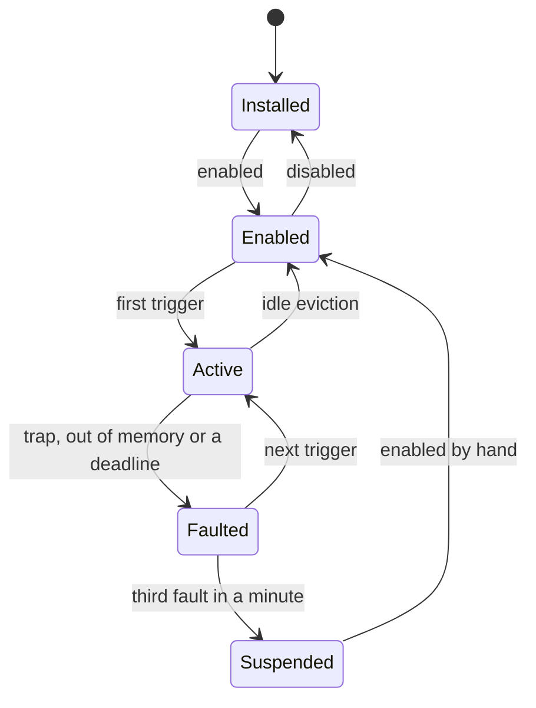

# Plugins

A plugin is a WebAssembly module and a manifest, `yapfast-plugin.json`, read
from a git repository and pinned there to one commit. Yapfast runs the module in
a helper process of its own, [`yapfast-plugins`](../../crates/yapfast-plugin-host),
and talks to it over a pipe of JSON frames. The helper holds no Discord token,
no Matrix session, no network stack and no filesystem; a guest asks Yapfast for
everything through one host function, and the parent answers it. What a plugin
may do is written in its manifest and agreed to at install, line by line:
[permissions](permissions.md).

Plugins are behind a Cargo feature, `plugins`, and the helper is a separate
binary, so a build without them links neither wasmtime nor `gix`.

## The documents here

| Reads like | Is |
| --- | --- |
| This one | What the plugin system is, what exists, and what doesn't yet |
| [`interface.md`](interface.md) | What a plugin changes in the interface: slots, widgets, named parts |
| [`settings.md`](settings.md) | A plugin's own settings: declaring them, the page that draws them |
| [`manifest.md`](manifest.md) | Every field of `yapfast-plugin.json` |
| [`abi.md`](abi.md) | The frames on the pipe, and the five exports a guest has |
| [`host.md`](host.md) | The helper: its threads, lanes, deadlines, faults and cache |
| [`permissions.md`](permissions.md) | Capabilities, consent, and the network gate |
| [`marketplace.md`](marketplace.md) | The registry repository: entries, icons, review and CI, browsing and updates |
| [`pdk.md`](pdk.md) | Writing a plugin, in Rust, C, Zig or AssemblyScript |
| [`testing.md`](testing.md) | Fixtures, fake Discord, and the measurements |

## The lifecycle

| State | What exists |
| --- | --- |
| Installed | Files under `store/`, and a line in the lock file. Nothing in memory. |
| Enabled | One registry entry in the parent: the manifest's contributions, its permissions and its subscription bits. The helper needn't be running. |
| Active | An instance in the helper, with the pages of memory its manifest asked for. |
| Faulted | It trapped, ran out of memory or missed a deadline. Its instance is gone and it is re-instantiated on its next trigger. |
| Suspended | Three faults in a minute. It stays off until the person enables it again. |



Enabling a plugin adds its registry entry and checks its dependencies; it starts
no process. A plugin names what wakes it, `startup`, `command`, `menu` or
`event:message_create` and the like, and is instantiated when one of those
happens. A person waiting on the result is what forces the two exceptions: a
plugin that intercepts outgoing messages is activated at startup, since the first
message must not go out before it is ready, and so is any plugin whose manifest
says `startup`.

**The helper exists only while an instance does.** The parent starts it on the
first activation, and it exits when the last instance is evicted, so wasmtime's
compile threads and a guest's linear memory never outlive the plugins that
needed them. With nothing enabled there is no helper, no thread and no timer:
`AppState` carries no plugin state at all, and the tap points in the send path,
the event path and the menus cost one check each. A plugin that has been
installed but never triggered costs its registry entry.

An instance is evicted after five minutes with no calls, at once when the window
closes to the tray, and when the helper's memory budget is full. A plugin holding
a timer or an open request isn't idle. The contract that follows, and that a
plugin's author has to write to: an instance may vanish between any two calls,
so anything that must survive goes in storage.

A run started with `--no-plugins` reads no plugin and starts no helper, which is
how someone gets their window back when a plugin has made it unusable; the next
run without the flag has its plugins again, since nothing was uninstalled.

## What a plugin can add

Everything the interface shows before a plugin runs is in its manifest, so a
plugin that has never been activated still appears:

- commands in the composer's `/` list, with typed and required options;
- rows in a message, person, channel, server, role, emoji, sticker, image,
  stream, game, composer or attachment menu, with a closed set of `when`
  conditions and no expression language;
- settings the plugin's page draws for it, as strings, numbers, sliders,
  switches, choices and lists of records;
- named switches, `tweaks`, for parts of Yapfast that offer them.

Once it is running it can subscribe to events and answer with data to draw: text
and controls beside a message, or inside a slot the interface offers. The
interface is compiled Slint, so a plugin adds no widget; it sends a tree and
precompiled components draw it.

A plugin can also talk to another: `plugin.call` runs one of the other's exports
and answers with what it returned, and `plugin.publish` hands bytes to whoever
subscribed to a topic with `plugin.subscribe`. A call follows the dependency
edges its manifest declares and no others, so two plugins can't call each other
in a loop and neither waits on something that waits on it; a call that would
come back around is refused with the chain that made the loop. A call wakes a
callee that was evicted, and an update of a plugin never leaves a plugin that
needs it running against nothing: the dependents are stopped in reverse
dependency order, the version is swapped with the plugin's handed-on state, and
they are started again. A call made during that moment waits rather than being
told the plugin isn't installed.

What it can't do is become Yapfast. A guest gets no Discord or Matrix token, no
raw authenticated request, no direct socket and no filesystem; network access is
one gated HTTPS fetch to the hosts its manifest names, and nothing else. It can't
answer with a shape the ABI doesn't define, and a host method this build doesn't
have answers `unsupported`, so a plugin feature-detects instead of failing to
load.

## Where the files live

Everything is in the data directory (the one `--data-dir` names), under
`plugins/`:

```text
<data>/plugins/
  lock.json               what is installed, with its pinned commit and hashes
  grants.json             what the person allowed, per plugin and per host
  store/<sha256>/         content-addressed: plugin.wasm and manifest.json
  data/<id>/              the plugin's own storage.json and settings.json
  cache/                  wasmtime's compile cache, safe to delete
```

A plugin loaded from a folder is installed the same way: its manifest and module
are read into `store/`, and it is filed under the folder that holds them, so it
can't be confused with a plugin from a repository. Its saves reload it; see
[the helper](host.md#development-reload).

`store/` is content-addressed because a git object name is a SHA-1 of the commit,
not of the bytes that run: the lock file records the commit it was installed
from, the SHA-256 of the `.wasm` and the SHA-256 of the manifest it was reviewed
with, and the module is hashed before its path is handed to anything. The current
and previous version of each plugin stay in `store/`, so a rollback needs no
fetch. With no plugin enabled, none of it exists: Yapfast creates the directory
when it first installs a plugin and not before.

## The other pages

| Page | What it covers |
| --- | --- |
| [Manifest](manifest.md) | Every field of `yapfast-plugin.json`, its limits and what validation refuses |
| [ABI](abi.md) | The pipe frames, the guest's exports and imports, and the JSON each one carries |
| [Permissions](permissions.md) | Every capability and its sentence, the network gate, grants and revoking them |
| [The helper](host.md) | The helper's threads, lanes, deadlines, faults, eviction, cache and crashes |
| [Writing a plugin](pdk.md) | The Rust PDK, a plugin end to end, and the eviction contract |
| [Testing](testing.md) | The `.wat` fixtures, the helper and gate tests, and measuring memory |

## What isn't wired yet

The core is in place: the helper and its scheduler, the Extism runtime, the bridge
with its registry and store, the content-addressed store and the `fetch`
subcommand, permissions, the network gate and the dialog that asks about a host,
grants and the page that revokes them, the application's actions and taps, the
Rust PDK, and the fixtures and tests for all of it.

Two things are deliberately not there yet:

- **Chunked response bodies.** A body larger than one frame is refused rather
  than streamed to a file, because the answer has no field naming the file.
- **Matrix messages.** Selection, voice, focus and account-ready events are
  tapped where both networks pass; a Matrix message isn't tapped yet, so only
  Discord's gateway feeds `message_create`, `message_update` and
  `message_delete`.

Beyond those, every method the first version of the API names is answered:
`storage`, `settings`, `http`, `timers`, `ui`, `notify`, `clipboard`, `open`, the
`app`, `account`, `rooms`, `messages` and `people` groups, and the `plugin`
group's `call`, `publish` and `subscribe`. A method this build doesn't have
answers `unsupported`, which is what a plugin feature-detects on. What the API
still doesn't have is [§17.2](../../PLAN.md#172-additions-to-the-api)'s
additions: the curated actions (`presence`, `mark_read`, `set_mute`,
`open_room`, `start_reply`, `start_edit`, `reactors`, `pause_invites`,
`add_emoji`, `add_sticker`), `media.get`, retention, `code_block.render`,
providers, audio and the microphone, and the changes to
built-in UI beyond the part hides and the colour and size overlay. The hooks are
`message.pre_send`, `message.pre_edit`, `typing.pre_send` and
`attachment.pre_upload`, with `message.decorate` drawn through `yf_decorate` and
`identity.decorate` answered through `yf_identity` once per (person, server);
`activity.pre_publish` exists in the ABI and Yapfast publishes no activity to run
it on.
`docs/plugins/manifest.md` lists the fields; a manifest may declare `menus`,
`settings` and `tweaks` that nothing draws yet.
